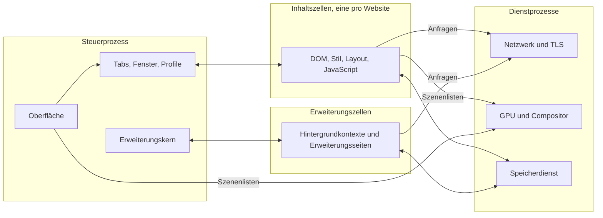
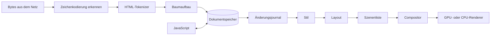
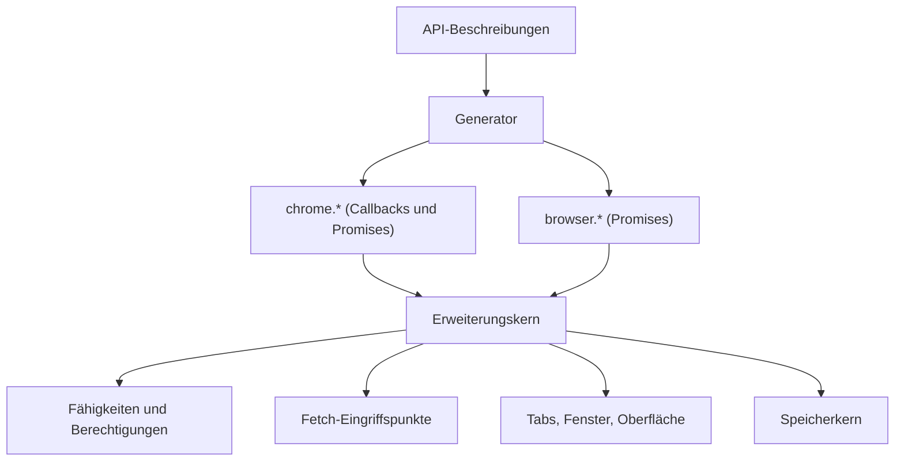

# MeinBrowser – Architekturkonzept

Stand: Entwurf vom 24.10.2026 · Status: zur Diskussion

Dieses Dokument beschreibt, wie MeinBrowser aufgebaut werden soll: welche Bausteine es gibt, wo wir bewusst andere Wege gehen als heutige Browser, wie die eigene JavaScript-Engine aussieht, wie Chrome- und Firefox-Erweiterungen laufen sollen und in welcher Reihenfolge wir bauen. Es ist ein Entwurf. Alles, was noch entschieden werden muss, steht gesammelt in [Abschnitt 14](#14-offene-entscheidungen).

## Inhalt

1. [Ziele und Leitplanken](#1-ziele-und-leitplanken)
2. [Die Grundideen](#2-die-grundideen)
3. [Gesamtbild](#3-gesamtbild)
4. [Die Komponenten im Einzelnen](#4-die-komponenten-im-einzelnen)
5. [Erweiterungen für Chrome und Firefox](#5-erweiterungen-für-chrome-und-firefox)
6. [Modifizierbarkeit und Skins](#6-modifizierbarkeit-und-skins)
7. [Ressourcenschonung](#7-ressourcenschonung)
8. [Sicherheit](#8-sicherheit)
9. [Plattformen](#9-plattformen)
10. [Kompatibilität messen](#10-kompatibilität-messen)
11. [Aufbau des Repositorys](#11-aufbau-des-repositorys)
12. [Roadmap und Meilensteine](#12-roadmap-und-meilensteine)
13. [Der Aufwand, ehrlich betrachtet](#13-der-aufwand-ehrlich-betrachtet)
14. [Offene Entscheidungen](#14-offene-entscheidungen)
15. [Quellen](#15-quellen)

---

## 1. Ziele und Leitplanken

**Ziele**

- **Open Source** unter der MIT-Lizenz (wie im Repository festgelegt).
- **Extrem ressourcenschonend**: wenig Arbeitsspeicher, schneller Start, kaum Energieverbrauch im Leerlauf.
- **Maximal kompatibel**: gemessen an den offiziellen Testsammlungen des Webs (web-platform-tests, Test262 und weitere, siehe [Abschnitt 10](#10-kompatibilität-messen)) und an echten Webseiten.
- **Erweiterungen**: Chrome- und Firefox-Erweiterungen laufen ohne Anpassung.
- **Sicher**: Weder Webseiten noch Erweiterungen noch Angreifer im Netzwerk kommen an Daten anderer Seiten oder an den Rechner (siehe [Abschnitt 8](#8-sicherheit)).
- **Modifizierbar und skinbar**: Aussehen und Verhalten lassen sich ändern, ohne den Browser neu zu übersetzen.
- **Läuft auf jedem System**: Linux, Windows und macOS zuerst, danach Android, BSD und weitere.
- **Eigene Engine und eigener Browsercode**: eine von Grund auf neue Engine ohne fremde Browser-Engines. Als begrenzte Ausnahme kann der Nutzer ein proprietäres Widevine-Modul für DRM aktivieren ([4.13](#413-bilder-audio-und-video)).

### 1.1 Was „komplett eigen“ hier bedeutet

Ganz ohne fremden Code kann kein Programm laufen: Um ein Fenster zu öffnen, ins Netz zu gehen oder die Grafikkarte zu nutzen, muss der Browser mit dem Betriebssystem sprechen. Entschieden am 24.10.2026: Erlaubt sind die Rust-Standardbibliothek sowie die Schnittstellen von Betriebssystem und Grafiktreibern. Den Browsercode darüber bauen wir selbst, auch TLS und Kryptografie. Ergänzend ist ein optionales Widevine-CDM als eng begrenzte Laufzeitausnahme erlaubt; die eigene Engine bleibt davon unabhängig. Im Einzelnen:

| Kategorie | Regel |
|---|---|
| Browserkern und Engine | Alles selbst geschrieben: Parser, DOM, CSS, Layout, Rendering, Schriften, JavaScript, WebAssembly, Netzwerk, TLS, Bilder, Medien, Erweiterungen, Oberfläche. |
| Optionales DRM-Modul | Ein externes, proprietäres Widevine Content Decryption Module (CDM) ist als begrenzte Ausnahme erlaubt. EME-Schnittstelle und CDM-Host schreiben wir selbst; das Modul läuft getrennt und wird nur nach Zustimmung bezogen und aktiviert. Es ist keine Cargo-Abhängigkeit des Browserkerns. Bezug und etwaige Weitergabe setzen entsprechende Rechte voraus; das CDM erhält durch die Browser-Lizenz keine MIT-Lizenz. |
| Rust-Sprache und Standardbibliothek | Erlaubt (`core`, `alloc`, `std`). |
| Schnittstellen des Betriebssystems | Erlaubt: Systemaufrufe, Fenster und Eingabe, Zwischenablage, Barrierefreiheit, Zertifikatsspeicher, Schlüsselbund. Die Anbindung (FFI-Deklarationen) schreiben wir selbst, also keine Crates wie `libc`, `windows-sys` oder `objc`. |
| Grafiktreiber-Schnittstellen | Erlaubt: Vulkan, Metal, Direct3D 12. |
| Werkzeuge, die nicht ausgeliefert werden | Annahme: erlaubt. Gemeint sind Compiler, Cargo, Git, Profiler und Fuzzing-Werkzeuge der Toolchain. Dazu kommt als einzige fremde Crate `libfuzzer-sys` im getrennten Fuzzing-Workspace `fuzz/` (entschieden am 30.10.2026, [14](#14-offene-entscheidungen)). |
| Testsammlungen | Annahme: erlaubt. web-platform-tests, Test262, html5lib-tests und andere sind Prüfmaßstab, kein Bestandteil des Browsers. |
| Datensätze, die man nicht erfinden kann | Annahme: erlaubt, eingelesen mit eigenen Generatoren. Dazu gehören die Unicode-Zeichendatenbank, CLDR, die IANA-Zeitzonendatenbank, die Public Suffix List, die Liste vertrauenswürdiger Wurzelzertifikate, die HSTS-Preload-Liste, Silbentrennmuster und die IDL-Blöcke aus den Spezifikationen. Die Lizenzen jedes Datensatzes dokumentieren wir im Repository. |

**Durchsetzung:** Eine CI-Prüfung (`tools/deps-guard`) lehnt jeden Pull Request ab, dessen `Cargo.lock` ein Paket mit externer Quelle enthält (also mit einem `source`-Eintrag). Weil Pfadabhängigkeiten keinen solchen Eintrag haben, prüft sie zusätzlich die Metadaten von Cargo mit allen Features: Jedes Paket im Abhängigkeitsgraphen, auch optionale Abhängigkeiten, muss ein Mitglied des Workspace sein, und sein Manifest muss nach dem Auflösen symbolischer Verweise im Workspace liegen. Im getrennten Fuzzing-Workspace prüft sie `fuzz/Cargo.lock`: Fremd darf dort nur sein, was `libfuzzer-sys` von crates.io mitbringt ([8.2](#82-schutzschichten), Punkt 14). So bleibt die Regel nicht nur ein Vorsatz. Ein separat geladenes CDM wird von dieser Cargo-Prüfung nicht erfasst und benötigt eine eigene Herkunfts-, Integritäts- und Updateprüfung nach [4.13](#413-bilder-audio-und-video). Die Widevine-Ausnahme erlaubt keine sonstigen fremden Bibliotheken im Browserkern.

### 1.2 Neu, wo es nützt, und exakt, wo das Web es verlangt

Webseiten sehen vom Browser nur sein Verhalten. Dieses Verhalten ist durch Spezifikationen festgelegt (WHATWG, W3C, TC39, Khronos, IETF) und in der Praxis zusätzlich durch das, was Chrome und Firefox tun. Hier dürfen wir nicht abweichen, sonst leidet die Kompatibilität.

Wie wir dieses Verhalten im Inneren herstellen, ist dagegen völlig frei. Dort setzen die Grundideen in [Abschnitt 2](#2-die-grundideen) an. Eine Einschränkung gilt trotzdem: Wo eine bekannte Technik nachweislich am besten funktioniert (zum Beispiel Inline-Caches für JavaScript-Eigenschaftszugriffe), bauen wir sie selbst nach, statt aus Prinzip eine schlechtere zu erfinden. Die Funktionalität soll unter dem Eigenbau nicht leiden.

---

## 2. Die Grundideen

Acht Entscheidungen prägen die Architektur. Zu jeder steht, was sie bringt und wo das Risiko liegt.

| Bereich | Häufiger Weg | MeinBrowser |
|---|---|---|
| Dokumentmodell | Objektbaum, jeder Knoten ein eigenes Heap-Objekt mit Zeigern | Spaltenspeicher mit 32-Bit-Indizes |
| Änderungen verfolgen | viele einzelne „dirty“-Markierungen je Subsystem | ein gemeinsames Änderungsjournal für alle |
| Spezifikationstreue | Spezifikationsschritte als Kommentare von Hand | Spezifikation als Quelltext, generiert und rückverfolgbar |
| Speicherfreigabe | ein Garbage Collector pro Prozess | Speicherregionen pro Dokument, beim Schließen sofort frei |
| Start neuer Fenster und Frames | eingebaute Objekte werden je Realm neu erzeugt oder aus einem Snapshot geladen | geteiltes, unveränderliches Abbild, Objekte entstehen erst bei Bedarf |
| Hintergrund-Tabs | verwerfen und beim Zurückkehren neu laden | einfrieren und als Abbild auslagern, ohne Neuladen |
| Grafik | häufig getrennte Rasterwege für Text und übrige Grafik | eine Vektorpipeline für alles, GPU und CPU rechnen gleich |
| Erweiterungen | je Browser ein eigenes API-Modell | ein Kern, `chrome.*` und `browser.*` aus einer Beschreibung erzeugt |

### 2.1 Spaltenspeicher statt Objektbaum

Das Dokument (DOM) ist kein Geflecht aus Objekten, sondern eine Tabelle. Jeder Knoten ist eine Nummer (32 Bit, plus Generationszähler gegen veraltete Verweise). Seine Eigenschaften liegen in Spalten: Knotenart, Elternknoten, erstes Kind, nächstes Geschwister, Name, Attribute, Text, berechneter Stil, Layout-Ergebnis, Markierungen.

- **Vorteile:** Wenig Speicher (32-Bit-Indizes statt 64-Bit-Zeigern, keine Verwaltungsdaten pro Einzelobjekt). Durchläufe sind cachefreundlich und lassen sich leicht auf Threads verteilen. Rust kommt damit natürlich zurecht, ohne `Rc<RefCell<…>>`-Geflechte. Ein ganzes Dokument lässt sich am Stück kopieren, einfrieren oder auf die Festplatte schreiben.
- **Risiko:** Manche DOM-Operationen (große Teilbäume verschieben, Knoten adoptieren) brauchen sorgfältige Freilisten und Kompaktierung. Das klären wir früh mit Messungen.

### 2.2 Ein Änderungsjournal für alles

Jede Änderung am Dokument landet in einem Journal: Knoten eingefügt, Attribut geändert, Text geändert. Alle Interessenten lesen dasselbe Journal: Stil-Invalidierung, Layout, `MutationObserver`, der Barrierefreiheitsbaum, die Entwicklerwerkzeuge und Erweiterungen.

- **Vorteile:** Eine einzige, prüfbare Stelle für „was hat sich geändert“. Fehler durch vergessene Invalidierung, eine häufige Fehlerquelle in Browsern, werden seltener. Neue Interessenten kommen ohne Eingriffe in den Kern hinzu.
- **Risiko:** Das Journal darf bei massenhaften Änderungen nicht zum Flaschenhals werden. Deshalb fasst es Folgen gleichartiger Änderungen zusammen und wird pro Darstellungsschritt geleert.

### 2.3 Spezifikation als Quelltext

Die WHATWG-Standards sind als Algorithmen geschrieben, viele davon als Zustandsautomaten (HTML-Tokenizer, Baumaufbau, URL-Parser, CSS-Syntax). Diese Teile beschreiben wir in einer kleinen eigenen Beschreibungssprache, nah am Wortlaut der Spezifikation. Ein eigener Generator erzeugt daraus Rust-Code, und jeder erzeugte Schritt trägt einen Verweis auf den Abschnitt der Spezifikation.

- **Vorteile:** Hohe Treue zur Spezifikation. Ändert sich ein Standard (die WHATWG-Standards werden laufend fortgeschrieben), meldet ein Werkzeug, welche referenzierten Abschnitte sich geändert haben. Die Abdeckung wird messbar.
- **Risiko:** Nicht alles lässt sich generieren. Layout und Grafik schreiben wir von Hand. Der Generator ist selbst Code, der gepflegt werden muss, deshalb setzen wir ihn nur dort ein, wo die Spezifikation wirklich tabellarisch ist.

### 2.4 Speicherregionen pro Dokument

Der JavaScript-Speicher ist in Regionen aufgeteilt: eine pro Agent (eine Ereignisschleife im Sinne der HTML-Spezifikation) und darin eine Unterregion pro Dokument. Objekte verschiedener Agents können sich laut Spezifikation nicht gegenseitig referenzieren, sie tauschen nur Kopien aus (`postMessage`, strukturiertes Klonen). Innerhalb einer Region arbeitet ein Garbage Collector mit Generationen.

- **Vorteile:** Wird ein Tab geschlossen, wird seine Region auf einen Schlag freigegeben, ohne Garbage-Collection-Lauf. Gibt es keine Verweise zwischen Dokumenten (der Normalfall), gilt das auch beim Wegnavigieren. Regionen lassen sich einzeln messen, begrenzen und einfrieren.
- **Risiko:** Gleichherkunfts-Frames dürfen Objekte teilen. Solche Verweise erfasst eine Schreibbarriere, und die betroffene Unterregion wird dann normal vom Garbage Collector behandelt statt pauschal freigegeben.

### 2.5 Geteilte, unveränderliche Abbilder

Alles, was in jedem Prozess gleich ist, wird beim Übersetzen einmal vorberechnet und als schreibgeschütztes Abbild per Speicherabbildung (`mmap`) von allen Prozessen geteilt: die Vorlagen aller eingebauten JavaScript-Objekte und DOM-Schnittstellen, das vorübersetzte Standard-Stylesheet, die Unicode-Tabellen. Systemschriften werden ebenfalls nur abgebildet, nicht kopiert.

Ein neues Realm (Fenster, Frame, Worker, Erweiterungskontext) erzeugt seine eingebauten Objekte erst, wenn ein Skript sie tatsächlich anfasst. Jedes Realm bekommt dabei weiterhin eigene Objekte, wie die Spezifikation es verlangt (`Array` im Frame ist nicht `Array` im Hauptdokument). Die Vorlagen dafür, also Gestalt, Eigenschaftstabellen und Code, kommen aus dem geteilten Abbild.

- **Vorteile:** Neue Realms starten fast ohne Kosten. Von vielen hundert DOM-Schnittstellen benutzt eine typische Seite nur einen Bruchteil.
- **Risiko:** Die verzögerte Erzeugung muss für Skripte unsichtbar sein. Das prüfen Test262 und die WPT-Tests zu WebIDL.

### 2.6 Einfrieren statt Verwerfen

Weil Dokument (Spaltenspeicher) und JavaScript-Speicher (Regionen) zusammenhängende Blöcke sind, lässt sich ein Hintergrund-Tab komplett einfrieren: anhalten, komprimieren, auf die Festplatte schreiben. Beim Zurückkehren wird er in seinem genauen Zustand wiederhergestellt, inklusive Formulareingaben, Scrollposition und Skriptzustand, ohne Neuladen.

- **Vorteile:** Sehr viele offene Tabs bei geringem Speicherverbrauch, ohne dass Seiten ihren Zustand verlieren.
- **Risiko:** Seiten mit offenen Verbindungen (WebSocket, WebRTC), laufender Wiedergabe oder geteiltem Speicher mit Workern lassen sich nicht ohne Verlust einfrieren. Für sie gelten Regeln ähnlich denen des Back-Forward-Caches der HTML-Spezifikation: Sie bleiben aktiv oder werden gedrosselt.

### 2.7 Eine Grafikpipeline für alles

Seiteninhalt, Text, Oberfläche und Skins laufen durch dieselbe Pipeline: Das Layout erzeugt eine kompakte Szenenliste (Pfade, Bilder, Glyphen, Effekte), die ein eigener, auf Compute-Shadern basierender Vektor-Renderer auf der GPU zeichnet. Ein CPU-Renderer mit denselben Algorithmen ist Rückfallebene und zugleich Referenz.

- **Vorteile:** Ein Codepfad statt mehrerer. Glyphen sind einfach Pfade. Die CPU-Variante macht Tests deterministisch und läuft auf jedem Gerät, auch ohne brauchbaren Grafiktreiber.
- **Risiko:** GPU-Vektorrasterung mit Compute-Shadern ist ein aktives Forschungsgebiet und anspruchsvoll. Für alte GPUs ohne Compute-Unterstützung zeichnet die CPU und lädt nur fertige Kacheln hoch.

### 2.8 Ein Erweiterungskern, zwei Gesichter

Intern gibt es genau ein Modell für Erweiterungen, mit Fähigkeiten (Capabilities) statt verstreuter Berechtigungsprüfungen. Die APIs beschreiben wir einmal in einem eigenen Beschreibungsformat. Ein Generator erzeugt daraus `chrome.*` (Callbacks und Promises) und `browser.*` (Promises, Firefox-Stil), samt Argumentprüfung und Testgerüsten. Details stehen in [Abschnitt 5](#5-erweiterungen-für-chrome-und-firefox).

---

## 3. Gesamtbild

### 3.1 Prozesse und Zellen

Seit den Spectre-Angriffen gilt: Inhalte verschiedener Websites gehören in getrennte Betriebssystemprozesse, weil Seitenkanäle Speicher innerhalb eines Prozesses auslesen können. Wir nennen eine solche Isolationseinheit **Zelle**.



- **Steuerprozess:** Oberfläche, Tab- und Fensterverwaltung, Profile, Berechtigungen, Erweiterungskern. Er hat die meisten Rechte und führt kein Webseiten-JavaScript aus.
- **Dienstprozesse:** Netzwerk (inklusive TLS und Cookies), GPU und Compositor, Speicherdienst (IndexedDB, Cache, Verlauf). Auf Geräten mit wenig Speicher lassen sie sich zu einem einzigen Dienstprozess zusammenlegen.
- **Inhaltszellen:** eine pro Website (Schema plus registrierbare Domain laut Public Suffix List). Sie sind stark eingeschränkt (Sandbox) und kommen an Dateien, Netz und Grafik nur über Nachrichten an die anderen Prozesse.
- **Erweiterungszellen:** Hintergrundkontexte, Popups und Optionsseiten von Erweiterungen.
- **Prozesskommunikation (IPC):** eigene, typisierte Nachrichten über Ringpuffer in gemeinsamem Speicher. Die Nachrichtentypen werden aus einer Schnittstellenbeschreibung generiert, damit Absender und Empfänger nie auseinanderlaufen.

### 3.2 Der Weg einer Seite



1. Der Netzwerkprozess liefert Bytes. Die Zeichenkodierung wird nach dem Encoding-Standard erkannt.
2. Tokenizer und Baumaufbau (generiert nach [2.3](#23-spezifikation-als-quelltext)) füllen den Dokumentspeicher. Skripte können den Parser laut Spezifikation anhalten und weiterschreiben (`document.write`).
3. Das Änderungsjournal sagt dem Stilsystem, welche Knoten neu zu berechnen sind.
4. Das Layout erzeugt einen unveränderlichen Fragmentbaum und daraus die Szenenliste.
5. Die Szenenliste geht über gemeinsamen Speicher an den Compositor. Er übernimmt Scrollen und einfache Animationen (Verschiebung, Transparenz) selbst, sodass Scrollen flüssig bleibt, auch wenn JavaScript gerade rechnet.

### 3.3 Threads und Planung

- Jede Inhaltszelle hat einen Hauptthread für die Ereignisschleife (wie es die HTML-Spezifikation vorgibt) und einen gemeinsamen Pool von Hilfsthreads für Stil, Layout, Bilddekodierung, Textformung und Garbage Collection.
- Ein eigener Planer verteilt Arbeit nach Priorität: Eingaben vor Animationsbildern, vor Darstellung, vor normalen Aufgaben, vor Leerlaufarbeit.
- Ein-/Ausgabe läuft über eine eigene Ereignisschicht auf den Mechanismen des Systems: `epoll` unter Linux, `kqueue` unter macOS und BSD, IOCP unter Windows.
- Leerlauf heißt Leerlauf: kein Abfragen in Schleifen, gebündelte Timer, keine Darstellung ohne Änderung.

---

## 4. Die Komponenten im Einzelnen

Dieser Abschnitt beschreibt das Ziel. Was davon schon umgesetzt ist, steht im Stand in [Abschnitt 11](#11-aufbau-des-repositorys).

### 4.1 Fundament

Gemeinsame Bausteine für alle anderen Teile: Arenen und typisierte Indizes, Interning von Zeichenketten (Atome für Tag- und Attributnamen), Bitmengen, kompakte Zeichenketten (Latin-1 oder UTF-16), Fehler- und Protokollierungstypen sowie ein Speicherzähler je Subsystem, damit jeder Bereich seinen Verbrauch kennt.

### 4.2 Plattformschicht

Die einzige Stelle, die mit dem Betriebssystem spricht. Sie bietet dem Rest eine kleine, einheitliche Schnittstelle: Fenster, Eingabeereignisse, Zwischenablage, GPU-Oberfläche, Ein-/Ausgabe-Ereignisse, Dateizugriff, Prozesse und Sandbox, Systemschriften, Zertifikatsspeicher, Schlüsselbund, Barrierefreiheit und Eingabemethoden.

| System | Fenster und Eingabe | Grafik |
|---|---|---|
| Linux | eigener Wayland-Client und eigener X11-Client (beides dokumentierte Protokolle über Sockets, ohne `libwayland` oder `libX11`); der X11-Client steht, unter Wayland läuft er bis zum eigenen Wayland-Client über XWayland | Vulkan, sonst CPU über gemeinsamen Speicher |
| Windows | Win32 | Direct3D 12, alternativ Vulkan, sonst CPU |
| macOS | AppKit über die Objective-C-Laufzeit | Metal, sonst CPU |
| Android | NDK-Schnittstellen (Native Activity) | Vulkan, sonst CPU |

Unter Linux sind viele „Systemfunktionen“ in Wirklichkeit Bibliotheken (fontconfig, libdbus, libwayland). Diese ersetzen wir durch eigene Implementierungen der zugrunde liegenden Protokolle und Dateiformate, zum Beispiel einen eigenen D-Bus-Client für Barrierefreiheit und Eingabemethoden.

### 4.3 Text und Unicode

- **Unicode-Tabellen** generieren wir aus der Unicode-Zeichendatenbank: Eigenschaften, Normalisierung (UAX #15), bidirektionaler Text (UAX #9), Zeilenumbruch (UAX #14), Segmentierung (UAX #29), internationalisierte Domainnamen (UTS #46).
- **Schriften:** eigener Leser für TrueType, OpenType (inklusive CFF und CFF2), variable Schriften, Farbschriften für Emoji (COLR, CBDT, sbix), WOFF und WOFF2 (mit eigenem Brotli-Dekoder). Für einige Systemschriften von macOS brauchen wir zusätzlich AAT-Tabellen.
- **Textformung (Shaping):** eigene Umsetzung von OpenType GSUB und GPOS, zuerst für lateinische, kyrillische und griechische Schrift, danach Arabisch, Hebräisch, indische Schriften, Thai und ostasiatische Schriften. Das ist einer der aufwendigsten Teile des ganzen Projekts.
- **Glyphen** sind Pfade und laufen durch die normale Grafikpipeline. Kleine Größen werden in einem Glyphenatlas zwischengespeichert.
- **Schriftauswahl und Ersatzschriften:** eigener Index der Systemschriften (Verzeichnisse und Systemschnittstellen), zwischengespeichert pro Profil.

### 4.4 Parser

| Parser | Grundlage | Hinweis |
|---|---|---|
| Zeichenkodierung | WHATWG Encoding | alle dort gelisteten Kodierungen, Tabellen aus den Daten des Standards generiert |
| URL | WHATWG URL | generierter Zustandsautomat, IDNA aus UTS #46 |
| HTML | WHATWG HTML | Tokenizer und Baumaufbau generiert, inklusive Fehlerbehandlung und Quirks-Modus |
| XML und XHTML, SVG | XML 1.0, Namespaces | eigener, nicht validierender Parser |
| CSS | CSS Syntax Level 3 | Tokenizer und Grundgrammatik generiert, Eigenschaftsgrammatiken aus einer Beschreibungsdatei |
| JSON | ECMA-404 | geteilt mit der JavaScript-Engine |
| JavaScript und WebAssembly | ECMA-262, WebAssembly | siehe [4.9](#49-javascript-und-webassembly) |

### 4.5 Dokumentspeicher (DOM)

- Spaltenspeicher wie in [2.1](#21-spaltenspeicher-statt-objektbaum), Änderungsjournal wie in [2.2](#22-ein-änderungsjournal-für-alles).
- JavaScript-Wrapper sind schlanke Verweise der Form (Realm, Knotennummer, Generation). Darum können mehrere Welten (Seite und Inhalts-Skripte von Erweiterungen) denselben Knoten mit getrennten Wrappern sehen, was die Erweiterungen in [Abschnitt 5](#5-erweiterungen-für-chrome-und-firefox) brauchen.
- Shadow DOM, Slots, Custom Elements, Ranges und Selection und `TreeWalker` setzen auf denselben Spalten auf.
- Darstellung und Skript sehen konsistente Versionen: Der Renderer liest einen Schnappschuss, während das Skript schon weiterarbeitet.

### 4.6 Stil

- Eigener Selektor-Abgleich mit Vorfiltern über die Vorfahrenkette, Kaskade mit Ebenen (`@layer`), Containerabfragen, `:has()` und Verschachtelung.
- **Stil-Interning:** Gleiche berechnete Stile werden nur einmal gespeichert. Die meisten Knoten einer Seite teilen sich wenige Stilvarianten.
- Berechnung parallel über Teilbäume, angestoßen durch das Änderungsjournal.
- Animationen und Übergänge (CSS Animations, Transitions, Web Animations) laufen über eine gemeinsame Zeitleiste. Was der Compositor allein kann, gibt die Zelle an ihn ab.

### 4.7 Layout

- **Layout als reine Funktion:** Eingabe sind ein Knoten und die Randbedingungen (verfügbare Breite und Höhe, Schreibrichtung), Ausgabe ein unveränderliches Fragment. Ergebnisse werden nach (Knoten, Randbedingungen, Stilversion) zwischengespeichert. Erneutes Layout berechnet nur, was sich wirklich geändert hat.
- **Formatierungskontexte** (Block, Inline, Flex, Grid, Tabelle, Mehrspaltig, Positionierung, Floats) sind getrennte Module mit gemeinsamer Schnittstelle. Unabhängige Kontexte werden parallel berechnet.
- **Inline-Layout:** Bidi, Zeilenumbruch, Silbentrennung, vertikale Schrift, Ruby.
- **Später:** Seitenlayout für den Druck (Paged Media).

### 4.8 Grafik

- **Szenenliste:** kompaktes Binärformat mit Pfaden, Bildern, Glyphenfolgen, Verläufen, Masken, Filtern und Mischmodi. Inhaltszellen und Oberfläche erzeugen beide Szenenlisten.
- **GPU-Renderer:** Compute-Shader zerlegen Pfade in Kacheln und rastern sie (siehe [2.7](#27-eine-grafikpipeline-für-alles)).
- **CPU-Renderer:** dieselben Algorithmen in Rust, für Tests, Rückfall und Geräte ohne geeignete GPU.
- **Eigener Shader-Übersetzer:** Wir brauchen ihn ohnehin für WebGL (GLSL ES) und WebGPU (WGSL). Er übersetzt sowohl diese Sprachen als auch unsere eigenen Shader nach SPIR-V (Vulkan), MSL (Metal) und HLSL (Direct3D). Ein Übersetzer, drei Nutzer.
- **Compositor:** Ebenen für Scrollbereiche, Videos, Canvas und Animationen. Auch Frames aus anderen Inhaltszellen werden hier zu einem Bild zusammengesetzt.
- **Canvas 2D, WebGL, WebGPU** bauen auf derselben GPU-Abstraktion auf.

### 4.9 JavaScript und WebAssembly

Ziel ist vollständiges ECMAScript in der jeweils aktuellen Ausgabe einschließlich der Internationalisierungs-API (ECMA-402), gemessen mit Test262.

**Ausführungsstufen**

1. **Parser:** erzeugt einen kompakten Syntaxbaum in einer Arena. Funktionskörper werden zunächst nur vorgeprüft und erst beim ersten Aufruf vollständig übersetzt. Die „early errors“, die die Spezifikation vorschreibt, werden trotzdem sofort gemeldet.
2. **Bytecode:** registerbasiert mit Akkumulator und kompakt. Übersetzter Bytecode wird pro Skript-Hash auf der Festplatte zwischengespeichert, sodass wiederholte Besuche ohne erneutes Parsen auskommen.
3. **Interpreter:** läuft überall und ist die Grundlage für alle Plattformen, auch für die, auf denen kein JIT erlaubt ist. Aufrufe zwischen JavaScript-Funktionen laufen über einen eigenen Stapel von Rahmen statt über den Rust-Stapel, und Aufrufe in Endposition sind echte Endaufrufe (ECMA-262, Abschnitt 15.10).
4. **Basis-JIT:** setzt vorgefertigte Maschinencode-Bausteine je Bytecode zusammen, zuerst für x86_64 und AArch64.
5. **Optimierender JIT (später):** eigene SSA-Zwischendarstellung, die JavaScript und WebAssembly gemeinsam nutzen. Ein Backend, zwei Sprachen.

Ein JIT-freier Modus bleibt immer verfügbar, als Sicherheitsoption und für eingeschränkte Plattformen.

**Laufzeit**

- **Objektmodell:** Objektgestalten (Shapes) mit Inline-Caches, dichte und dünn besetzte Array-Elemente. Das ist bewährte Technik, die wir eigenständig umsetzen.
- **Werte:** 64-Bit-Darstellung mit eingebetteten Zahlen (NaN-Boxing, ganze Zahlen im Bereich von `i32` mit eigenem Kennzeichen). In Objekten gespeicherte Verweise sind innerhalb einer Region 32-Bit-Abstände (Regionen bis 4 GiB), das spart Speicher.
- **Speicher:** Regionen wie in [2.4](#24-speicherregionen-pro-dokument), präziser und verschiebender Garbage Collector mit Generationen. Die erste Ausbaustufe sammelt kopierend nach Cheney und kommt wie der Interpreter ohne `unsafe` aus, das braucht erst der JIT. Verweise aus Rust-Code laufen über typisierte, bereichsgebundene Handles, sodass der Collector jeden Verweis kennt.
- **Zeichenketten:** Latin-1 oder UTF-16 je nach Inhalt, Ropes für zusammengesetzte Ketten, Interning für Eigenschaftsnamen.
- **Reguläre Ausdrücke:** eigene Engine mit der vollen JavaScript-Semantik (Rückverweise, Lookbehind, Unicode-Sets) und einem Automaten-Schnellpfad für einfache Muster.
- **Intl:** Daten aus CLDR und der IANA-Zeitzonendatenbank, mit eigenem Generator in kompakte Tabellen übersetzt.
- **Eingebaute Objekte** kommen aus dem geteilten Abbild ([2.5](#25-geteilte-unveränderliche-abbilder)).

**WebAssembly**

Eigener Validierer, Interpreter und Basis-Übersetzer. Später teilt es sich das optimierende Backend mit JavaScript. Zuerst kommt der Kernstandard, danach Erweiterungen wie Threads, SIMD, Ausnahmen und Garbage Collection.

### 4.10 Web-APIs und Bindings

- Die Schnittstellen der Webplattform sind in den Spezifikationen in WebIDL beschrieben. Ein eigenes Werkzeug zieht die IDL-Blöcke aus den Spezifikationen, und ein eigener Generator erzeugt daraus die Bindings: Typumwandlung, Argumentprüfung, Ausnahmen, Prototypen. Rust-Code implementiert nur noch die eigentliche Logik.
- Die Ereignisschleife, Timer, Microtasks und `requestAnimationFrame` folgen exakt dem Verarbeitungsmodell der HTML-Spezifikation.
- **Worker, Service Worker und Worklets** sind eigene Agents mit eigener Region.

### 4.11 Netzwerk und Kryptografie

- **Protokolle:** HTTP/1.1 (RFC 9112), HTTP/2 (RFC 9113 mit HPACK), HTTP/3 (RFC 9114 über QUIC nach RFC 9000, mit QPACK), WebSocket, später WebTransport.
- **Fetch:** Der Fetch-Standard wird als ein einziger Zustandsautomat umgesetzt, den Seiten, Worker, Service Worker und Erweiterungen gemeinsam nutzen. Die Eingriffspunkte für Erweiterungen (`webRequest`, `declarativeNetRequest`) liegen an fest definierten Stellen dieses Automaten.
- **Weitere Bausteine:** HTTP-Cache, Cookies (inklusive Partitionierung), HSTS, CORS, CSP, gemischte Inhalte, Proxy-Unterstützung. PAC-Dateien sind JavaScript und laufen in unserer eigenen Engine.
- **DNS:** eigener Resolver, der die Systemkonfiguration liest, plus DNS über HTTPS (RFC 8484).
- **Kompression:** eigene Dekoder für gzip und Deflate, Brotli und zstd.
- **TLS:** eigene Umsetzung von TLS 1.3 (RFC 8446) und TLS 1.2 für ältere Server, Zertifikatsprüfung mit eigenem ASN.1-, DER- und X.509-Code. Die Wurzelzertifikate kommen aus dem Systemspeicher oder aus einer mitgelieferten Liste.
- **Kryptografie:** AES-GCM, ChaCha20-Poly1305, SHA-2, HMAC, HKDF, X25519, ECDSA P-256 und P-384, RSA, Ed25519 sowie die hybride Post-Quanten-Schlüsselvereinbarung X25519MLKEM768, die aktuelle Browser standardmäßig anbieten. Dieselben Bausteine bedienen die Web Crypto API.

**Wichtig zur Kryptografie:** Wir schreiben sie selbst (siehe [1.1](#11-was-komplett-eigen-hier-bedeutet)). Selbst geschriebene Kryptografie ist aber ein ernstes Sicherheitsrisiko. Schon kleine Fehler, etwa Laufzeiten, die von geheimen Daten abhängen, können Schlüssel verraten. Deshalb gilt:

- Die Kryptografie liegt hinter einer schmalen Anbieter-Schnittstelle, damit sie bei Bedarf austauschbar ist.
- Jede Primitive wird gegen offizielle Testvektoren geprüft (NIST, RFCs, Project Wycheproof), gefuzzt und auf konstante Laufzeit untersucht.
- Vor einer öffentlichen Version prüft ein externes Audit diesen Teil.

### 4.12 Speicherung

Ein eigener, absturzsicherer Speicherkern (Schreib-Log plus B-Baum) trägt alles, was dauerhaft gespeichert wird: Cookies, `localStorage`, IndexedDB, Cache API, das Origin Private File System, Verlauf, Lesezeichen, Einstellungen und Erweiterungsspeicher. Passwörter werden zusätzlich mit dem Schlüsselbund des Systems verschlüsselt.

### 4.13 Bilder, Audio und Video

- **Bilder:** PNG, APNG, JPEG (Baseline und progressiv), GIF, WebP (VP8 und VP8L), AVIF (AV1), BMP, ICO, SVG (über die eigene Engine). Bilder werden erst beim Zeichnen in der angezeigten Größe dekodiert und außerhalb des Sichtbereichs wieder verworfen.
- **Audio und Video:** HTML-Medienelemente, Media Source Extensions, Web Audio, später WebRTC. Lizenzfreie Codecs implementieren wir selbst: VP8, VP9, AV1, Opus, Vorbis, FLAC, MP3.
- **Patentbelastete Codecs** (H.264, AAC, HEVC) brauchen sehr viele Webseiten. Hier ist zu entscheiden, ob wir sie über die Medienschnittstellen des Betriebssystems nutzen, die zugleich Hardwaredekodierung bieten. Die Patentlage muss vor einer Veröffentlichung geklärt werden.
- **DRM:** Die EME-Schnittstelle (*Encrypted Media Extensions*), den CDM-Host und die Anbindung an das eigene Mediensystem entwickeln wir selbst. Zusätzlich ist die optionale Nutzung eines proprietären Widevine-CDM vorgesehen. Ein eigenes CDM wäre technisch möglich, benötigt für Inhalte fremder Anbieter aber deren Zusammenarbeit; es ersetzt Widevine bei bestehenden Diensten nicht automatisch.

**Festgelegte Grenzen für die optionale Widevine-Anbindung:**

- **Freiwillig und bedarfsweise:** Widevine ist standardmäßig deaktiviert. Bezug, Installation und Aktivierung erfolgen nur nach informierter Zustimmung. Der CDM-Prozess startet erst für erlaubte DRM-Nutzung; DRM-freie Wiedergabe benötigt ihn nicht. Modul und lokale DRM-Daten müssen entfernbar sein.
- **Eigene Sicherheitsgrenze:** Der selbst geschriebene CDM-Host lädt das Modul in einem eigenen eingeschränkten Prozess, mit schmaler, vollständig geprüfter IPC und Ressourcenlimits. Dateien, Netzwerk und gegebenenfalls geschützte Ausgabepfade werden nur über ausdrücklich freigegebene Schnittstellen vermittelt. Fehlt eine sichere Anbindung, bleibt diese Plattform-/CDM-Kombination nicht unterstützt.
- **Datenschutz:** Zugriffe werden pro Website freigegeben. Dauerhafte DRM-Sitzungen und unterscheidende Kennungen (*distinctive identifiers*) benötigen eine gesonderte Freigabe, soweit sie unterstützt werden. Lokale DRM-Daten werden nach Profil und Herkunft und, wo anwendbar, oberster Website getrennt und sind löschbar. Im Privatmodus wird kein dauerhafter DRM-Zustand angelegt. Verlangt ein Dienst darüber hinausgehende Rechte, kann seine Nutzung eingeschränkt sein.
- **Vertrauenswürdiger Bezug und Updates:** Nur ausdrücklich zugelassene CDM-Versionen aus berechtigten, geprüften Bezugswegen laden; Herkunft und Integrität auch bei Updates prüfen. Eine Website darf keine beliebige native Bibliothek als CDM vorgeben. Lizenzierung und eventuelle Weitergabe des Moduls sind gesondert zu klären.
- **Stand und Grenzen:** Die Anbindung ist noch nicht implementiert. Verfügbarkeit, Anbietervereinbarungen, Zertifizierungen, unterstützte Plattformen und CDM-Schnittstellen, Codecs sowie Ausgabeschutz sind gesondert zu prüfen. Unterstützung bestimmter Streamingdienste und HD-/4K-Wiedergabe sind damit nicht garantiert.

### 4.14 Sicherheit und Sandbox

Das Bedrohungsmodell und alle Schutzschichten im Überblick stehen in [Abschnitt 8](#8-sicherheit). Hier stehen die technischen Bausteine.

- **Rust schützt vor Speicherfehlern**, solange kein `unsafe` im Spiel ist. Darum steht in allen Crates außer wenigen ausgewiesenen (Plattformschicht, JIT, Garbage Collector, IPC) `#![forbid(unsafe_code)]`. Die Ausnahmen werden besonders geprüft und gefuzzt.
- **Sandbox je System:** unter Linux seccomp-bpf, Namespaces und Landlock, unter Windows AppContainer, eingeschränkte Tokens und Job-Objekte, unter macOS die Seatbelt-Sandbox.
- **Fähigkeiten statt Umgebungsrechten:** Eine Komponente bekommt nur Handles auf das, was sie braucht. Eine Inhaltszelle öffnet keine Dateien selbst, sie bekommt sie vom Steuerprozess, wenn der Nutzer sie ausgewählt hat.
- **JIT-Speicher** ist nie gleichzeitig beschreibbar und ausführbar (W^X).
- **Updates** sind signiert, und der Update-Mechanismus ist selbst geschrieben.

### 4.15 Barrierefreiheit und Eingabemethoden

- Der Barrierefreiheitsbaum entsteht aus Dokumentspeicher und Änderungsjournal und wird über die Systemschnittstellen bereitgestellt: UI Automation unter Windows, NSAccessibility unter macOS, AT-SPI über D-Bus unter Linux.
- Eingabemethoden für Chinesisch, Japanisch, Koreanisch und andere Sprachen laufen über TSF unter Windows, `NSTextInputClient` unter macOS sowie IBus oder Fcitx über D-Bus beziehungsweise das Wayland-Protokoll `text-input` unter Linux.
- Beides ist viel Arbeit, darf aber nicht bis zum Schluss warten. Ein Browser ohne Barrierefreiheit ist für viele Menschen nicht benutzbar.

### 4.16 Entwicklerwerkzeuge und Automatisierung

- Eigene Entwicklerwerkzeuge, gebaut mit der eigenen Engine.
- **Protokolle:** WebDriver (klassisch) und WebDriver BiDi, außerdem eine Teilmenge des Chrome DevTools Protocol. Damit lassen sich Werkzeuge wie Selenium und Puppeteer anbinden, und die vollständige Ausführung der web-platform-tests wird möglich.
- **Kopfloser Modus** (ohne Fenster) für Tests und Automatisierung.

---

## 5. Erweiterungen für Chrome und Firefox

### 5.1 Ziel

Erweiterungen aus dem Chrome Web Store und von addons.mozilla.org laufen ohne Änderung. Das betrifft Manifest V3 (Chrome und Firefox) und Manifest V2, das Firefox weiter unterstützt.

### 5.2 Aufbau



- **Ein internes Modell:** Eine Erweiterung besteht aus Manifest, Dateien, Fähigkeiten (aus `permissions` und `host_permissions`) und Kontexten: Hintergrund, Inhalts-Skripte, Erweiterungsseiten (Popup, Optionen, Seitenleiste) und Offscreen-Dokumente.
- **Eine Beschreibung pro API-Namensraum,** erstellt aus der öffentlichen Dokumentation von Chrome und MDN. Abweichungen zwischen den Browsern sind dort ausdrücklich markiert (nur Chrome, nur Firefox, unterschiedliches Verhalten). Der Generator erzeugt beide Gesichter, Argumentprüfung, Dokumentation und Testgerüste.
- **Hintergrund:** Chrome nutzt in Manifest V3 Service Worker, Firefox Hintergrundskripte und Event-Pages. Beides bilden wir auf denselben ereignisgesteuerten Kontext ab, der schlafen gelegt und bei Bedarf geweckt wird. Das spart Speicher.
- **Inhalts-Skripte** laufen in isolierten Welten: ein eigenes globales Objekt pro Erweiterung auf demselben DOM, möglich durch die schlanken Wrapper aus [4.5](#45-dokumentspeicher-dom). Firefox-Besonderheiten wie `wrappedJSObject`, `cloneInto` und `exportFunction` werden ebenfalls unterstützt.
- **Netzwerkeingriffe:** `declarativeNetRequest` wird in einen kompakten Regelautomaten übersetzt, schnell und speichersparend, was Werbeblockern zugutekommt. Blockierendes `webRequest` steht wie in Firefox in allen Manifest-Versionen zur Verfügung, auch für Chrome-Erweiterungen.
- **Pakete:** CRX3 (ZIP mit Protobuf-Kopf und Signaturen) und XPI (ZIP mit Signatur), gelesen mit eigenem ZIP-, Deflate- und Protobuf-Code.
- **Updates** über `update_url` (Chrome) beziehungsweise `browser_specific_settings.gecko.update_url` (Firefox).
- **Themes:** Chrome-Themes (`theme` im Manifest) und Firefox-Themes (`theme`-Schlüssel und Theme-API) werden auf die Design-Token aus [Abschnitt 6](#6-modifizierbarkeit-und-skins) abgebildet.
- **Native Messaging** startet das native Hilfsprogramm über die Prozessschnittstelle des Systems, wie in Chrome und Firefox.

### 5.3 Reihenfolge der APIs

1. `runtime`, `storage`, `i18n`, `permissions`, Inhalts-Skripte und `scripting`
2. `tabs`, `windows`, `action` und `browserAction`, `contextMenus`, `alarms`, `notifications`, `commands`
3. `declarativeNetRequest`, `webRequest`, `webNavigation`, `cookies`
4. `downloads`, `history`, `bookmarks`, `sidePanel` und `sidebarAction`, `offscreen`, `identity`
5. `devtools.*`, sobald die eigenen Entwicklerwerkzeuge stehen

### 5.4 Kompatibilität prüfen

Eine gemeinsame offizielle Testsammlung wie die WPT gibt es für Erweiterungs-APIs nach unserem Kenntnisstand nicht. Die W3C WebExtensions Community Group arbeitet an einer gemeinsamen Grundlage, der wir folgen. Wir bauen zusätzlich eigene API-Tests aus der Dokumentation und eine Liste realer Zielerweiterungen als Abnahmetest, zum Beispiel uBlock Origin, Dark Reader und Bitwarden.

Offen ist, wie die Installation direkt aus den Stores aussieht, denn beide Stores haben eigene Nutzungsbedingungen (siehe [Abschnitt 14](#14-offene-entscheidungen)).

---

## 6. Modifizierbarkeit und Skins

Der Browser soll sich auf vier Ebenen anpassen lassen, von einfach bis tief.

1. **Skins:** Die Oberfläche wird von der eigenen Engine gezeichnet, beschrieben in einer deklarativen Teilmenge von HTML und CSS. Ein Skin ist eine Datei mit Design-Token (Farben, Abstände, Schriften, Radien) plus beliebigem CSS für die Oberfläche. Skins lassen sich im laufenden Betrieb wechseln. Chrome- und Firefox-Themes werden automatisch übersetzt.
2. **Anordnung:** Leisten, Knöpfe und Seitenleisten sind frei anordenbar. Die Anordnung steht als Klartext in einer Datei und lässt sich teilen.
3. **Erweiterungen:** wie in [Abschnitt 5](#5-erweiterungen-für-chrome-und-firefox).
4. **Mods:** WebAssembly-Module mit einer eigenen Fähigkeiten-API für Oberfläche, Tabs, Tastenkürzel, eigene Panels und Netzwerk-Hooks. Mods sind abgeschottet, in jeder Sprache schreibbar, die nach WebAssembly übersetzt, und ohne Neustart nachladbar.

Darunter liegt der offene Quelltext mit klaren Crate-Grenzen. Feature-Schalter ermöglichen schlanke Varianten, etwa ohne WebGPU oder WebRTC für schwache Geräte.

Die Oberfläche selbst führt kein JavaScript aus. Ihre Logik ist in Rust geschrieben, eigene Logik kommt über Mods. Das spart einen ganzen JavaScript-Kontext im Steuerprozess. Popups und Optionsseiten von Erweiterungen sind dagegen normale Webseiten und laufen in Erweiterungszellen.

---

## 7. Ressourcenschonung

**Mechanismen**

1. Kompakte Datenstrukturen: 32-Bit-Indizes, Interning, Stil-Teilung ([2.1](#21-spaltenspeicher-statt-objektbaum), [4.6](#46-stil)).
2. Geteilte Abbilder für alles Unveränderliche ([2.5](#25-geteilte-unveränderliche-abbilder)).
3. Alles verzögert: Funktionskörper, eingebaute Objekte, Bilddekodierung, Schriftdaten.
4. Speicherbudgets mit Druckstufen: Unter Speicherdruck werden zuerst Caches geleert (Bilder, Glyphen, Bytecode), danach Hintergrund-Tabs eingefroren und ausgelagert ([2.6](#26-einfrieren-statt-verwerfen)).
5. Energie: keine Abfrageschleifen, gebündelte Timer, stark gedrosselte Hintergrund-Tabs, Darstellung nur bei Änderung, schlafender GPU-Prozess.
6. Zusammenlegbare Dienstprozesse auf schwachen Geräten ([3.1](#31-prozesse-und-zellen)).
7. Messen statt hoffen: Speicherzähler je Subsystem und Messläufe in der CI, damit Rückschritte sofort auffallen.

**Erste Zielwerte.** Das sind Ziele, keine Messungen. Wir überprüfen sie ab Meilenstein M5 an echter Hardware und passen sie an.

| Kennzahl | Zielwert |
|---|---|
| Kaltstart bis bedienbares Fenster | unter 300 ms |
| Zusätzlicher Arbeitsspeicher für einen leeren Tab | unter 10 MB |
| Aufwachvorgänge eines Hintergrund-Tabs im Leerlauf | höchstens einer pro Minute |
| Größe des Programms | unter 40 MB |

---

## 8. Sicherheit

Ein Browser führt ständig fremden Code aus und ist deshalb eines der wichtigsten Angriffsziele auf jedem Rechner. Viele Entscheidungen weiter oben sind darum zugleich Sicherheitsentscheidungen. Dieser Abschnitt bündelt sie, nennt das Bedrohungsmodell und ergänzt, was in den anderen Abschnitten fehlt.

### 8.1 Bedrohungsmodell

| Angreifer | Ziel | Wichtigster Schutz |
|---|---|---|
| Bösartige Webseite | Daten anderer Seiten lesen, aus der Sandbox ausbrechen, Code auf dem Rechner ausführen | Rust, Zellen pro Website, Sandbox, Fuzzing |
| Angreifer im Netzwerk | Verbindungen mitlesen oder verändern | TLS, Zertifikatsprüfung, HSTS, HTTPS zuerst |
| Bösartige oder übernommene Erweiterung | mehr Daten abgreifen, als ihre Berechtigungen erlauben | Fähigkeiten, Erweiterungszellen, Berechtigungsdialoge, Signaturen |
| Bösartiger Mod oder Skin | wie bei Erweiterungen | WebAssembly-Sandbox mit Fähigkeiten, Skins enthalten keinen Code |
| Täuschung des Nutzers | Phishing, gefälschte Adresszeile, gefälschte Dialoge | Regeln für die Oberfläche, Anzeige internationaler Domainnamen, Schutzlisten |
| Lieferkette | Schadcode über Abhängigkeiten, Build oder Updates | keine fremden Crates, abgesicherte CI, signierte Updates |

**Grundannahme:** Irgendwann wird eine Inhaltszelle trotz allem übernommen. Die Architektur muss dafür sorgen, dass eine übernommene Zelle nicht mehr kann als die Seite, die sie anzeigt. Sie darf weder an Daten anderer Websites noch an Dateien oder Netzwerkzugänge kommen, die der Steuerprozess ihr nicht gegeben hat.

### 8.2 Schutzschichten

Jede Schicht soll auch dann noch schützen, wenn die davor versagt hat.

1. **Speichersicherheit:** Rust, `unsafe` nur in drei Crates (`mb-platform`, `mb-ipc`, `mb-js`), jeder `unsafe`-Block mit Begründung. Die Workspace-Lints erzwingen das schon heute ([4.14](#414-sicherheit-und-sandbox)).
2. **Isolation:** eine Zelle pro Website, auch für Frames fremder Websites ([3.1](#31-prozesse-und-zellen)). Dazu kommen die Gegenmaßnahmen gegen Spectre, die die Webplattform vorsieht: Antworten fremder Herkunft, die eine Seite nicht lesen darf, gelangen gar nicht erst in deren Zelle (Opaque Response Blocking). `SharedArrayBuffer` und genaue Zeitmessung gibt es nur in herkunftsisolierten Seiten (COOP und COEP). Zeitstempel werden so vergröbert, wie es die High-Resolution-Time-Spezifikation vorsieht.
3. **Sandbox:** Die Mechanismen der Betriebssysteme aus [4.14](#414-sicherheit-und-sandbox). Eine Inhaltszelle hat keinen direkten Zugriff auf Dateien, Netz oder GPU.
4. **Misstrauische Prozessgrenzen:** Jede Nachricht aus einer Inhalts- oder Erweiterungszelle gilt als möglicherweise bösartig. Der Empfänger prüft sie vollständig, mit Prüfcode, der aus derselben Schnittstellenbeschreibung generiert wird wie die Nachrichten selbst. Die IPC ist der Hauptweg, um aus einer Sandbox auszubrechen, und wird deshalb besonders gefuzzt.
5. **GPU:** Grafiktreiber sind eine große Angriffsfläche. Darum laufen sie in einem eigenen Prozess, und Shader aus WebGL und WebGPU prüft unser Shader-Übersetzer vollständig, bevor ein Treiber sie sieht.
6. **JIT:** Fehler in JIT-Compilern sind in Browsern eine häufige Ursache schwerer Lücken. Gegenmaßnahmen: W^X, ein JIT-freier Modus als Einstellung, und differentielles Fuzzing, bei dem Interpreter und JIT dieselben Programme ausführen und gleiche Ergebnisse liefern müssen.
7. **Netzwerk:** TLS 1.3 bevorzugt, vollständige Zertifikatsprüfung, HSTS mit Preload-Liste, HTTPS zuerst (unverschlüsselte Verbindungen nur nach Warnung), Blockieren gemischter Inhalte, Prüfung von Certificate Transparency und von widerrufenen Zertifikaten (Verfahren noch offen, siehe [Abschnitt 14](#14-offene-entscheidungen)).
8. **Sicherheitsmechanismen der Webplattform,** exakt nach Spezifikation und mit den WPT getestet: Same-Origin-Policy, CORS, Content Security Policy, Trusted Types, Sandbox-Frames, Permissions Policy, Referrer Policy, SameSite-Cookies und sichere Kontexte für mächtige Funktionen.
9. **Berechtigungen:** Kamera, Mikrofon, Standort, Benachrichtigungen und Ähnliches nur mit Zustimmung, nur in sicheren Kontexten, pro Website widerrufbar.
10. **Oberfläche:** Die Adresszeile zeigt die Herkunft eindeutig. Internationale Domainnamen, die mit verwechselbaren Zeichen arbeiten, werden nach den Regeln von UTS #39 (Unicode Security Mechanisms) als Punycode angezeigt. Die Oberfläche des Browsers liegt immer außerhalb des Bereichs, in den eine Seite zeichnen kann. Vollbild und Mauszeigersperre werden deutlich angekündigt.
11. **Erweiterungen, Mods und Skins:** Berechtigungen werden vor der Installation angezeigt, Zugriff auf Websites lässt sich auch erst bei Bedarf erteilen. Erweiterungen laufen in eigenen Zellen, Inhalts-Skripte in isolierten Welten. Mods laufen in der WebAssembly-Sandbox und bekommen nur die Fähigkeiten, die der Nutzer freigibt. Skins sind reine Daten ohne Code und dürfen nur lokale Ressourcen laden, damit sie weder nachladen noch mitlesen können.
12. **Datenschutz:** Vorschlag: Speicher und Cookies werden standardmäßig nach der obersten Website getrennt (Partitionierung), damit eingebettete Inhalte Nutzer nicht über Websites hinweg verfolgen können.
13. **Lieferkette:** keine fremden Crates (der Abhängigkeitswächter läuft bereits in der CI; die Ausnahme für den Fuzzing-Workspace `fuzz/` steht in Punkt 14), keine fremden GitHub Actions (die CI holt den Quelltext selbst mit git; braucht es doch einmal eine Action, wird sie auf einen festen Commit-Hash festgelegt), reproduzierbare Builds als Ziel, Updates signiert mit einem Schlüssel, der nicht auf dem Build-Server liegt.
14. **Fehler finden, bevor andere es tun:** Fuzzing für jeden Parser ab dem ersten Tag (HTML, CSS, URL, JavaScript, Bilder, Schriften, Kompression, TLS, IPC-Nachrichten), nächtlich in der CI. Dafür gibt es `cargo-fuzz` mit libFuzzer in einem eigenen Cargo-Workspace unter `fuzz/`, mit eigenem Lockfile. `libfuzzer-sys` und die Crates, die es mitbringt, sind dort als einzige Ausnahme von „keine fremden Crates“ zugelassen; kein Crate des Browsers hängt von `fuzz/` ab, und weitere fremde Crates deckt die Ausnahme nicht; das prüft `tools/deps-guard` an `fuzz/Cargo.lock` ([Abschnitt 14](#14-offene-entscheidungen)). Elf Ziele prüfen HTML, CSS, URL, XML, PNG, GIF, Deflate/zlib, Schriften, JSON, Encoding und Unicode, das zwölfte (`page`) eine ganze Seite mit Stylesheets und Bildern durch Kaskade, Layout und Zeichnen, das dreizehnte (`js`) Lexer und Parser der JavaScript-Engine samt dem Parser für die Muster regulärer Ausdrücke und das vierzehnte (`js-runtime`) Operationsfolgen auf den vorhandenen Laufzeitbausteinen mit gewöhnlichen Objekten, Handles und Garbage Collection. Das Laufzeitziel vergleicht eigene Ausführungen bei unterschiedlichen Sammelzeitpunkten; Bytecode und Interpreter deckt es noch nicht ab. TLS und IPC erhalten Ziele mit ihren Implementierungen, weitere Teile der JavaScript-Engine mit ihren Stufen. Dauerhafte private Aufbewahrung von CI-Rohprotokollen, Fehlerdateien und neuen Korpora ist noch einzurichten. Ziele, Grenzen und der Umgang mit Funden stehen in [docs/fuzzing.md](fuzzing.md).
15. **Begrenzte Arbeit:** Was eine Seite an Rechenarbeit auslöst, bezahlt sie aus einem Budget mit festen Messstellen; ist es verbraucht oder bricht die Oberfläche den Auftrag ab, endet er mit einem Fehler statt weiterzurechnen. Bisher gilt das für Kaskaden-Vorbereitung, Stil und Layout (`mb_base::Budget`). Ebenso hat eine Seite ein Bytekontingent für Dokument, Stylesheets, Bilddateien und dekodierte Bilddaten (`mb_web::PAGE_BYTES`). Jeder Abruf erhält das Restbudget als Leselimit; bei null beginnt kein weiterer Abruf. Von lokalen Dateien liest sie nur normale Dateien, keine Geräte oder Pipes, mit der kleineren Grenze aus Restbudget und Dateilimit (`mb_web::read_file_within`). Das Kontingent ist keine Grenze für den gesamten RAM-Verbrauch: zusätzliche Parserdatenstrukturen und feste Tabellen der Dekoder sind davon nicht erfasst. Wiederholte Arbeit wie verschachtelte Selektoren wird innerhalb eines Auftrags gemerkt, damit das Budget nicht schon bei gewöhnlichen Seiten ausgeht.
16. **Umgang mit gemeldeten Lücken:** eine `SECURITY.md` mit vertraulichem Meldeweg (die private Schwachstellenmeldung von GitHub), Sicherheitshinweise zu jeder behobenen Lücke und schnelle Sicherheitsupdates. Vor Version 1.0 prüft ein externes Audit Kryptografie, Sandbox, IPC und JIT.

### 8.3 Sicherheit in jedem Meilenstein

| Meilenstein | Sicherheitsaufgaben |
|---|---|
| M0 | `SECURITY.md` und Meldeweg (erledigt), Abhängigkeitswächter (erledigt), keine fremden GitHub Actions (erledigt) |
| M1 | Arbeits- und Ladebudgets vorhanden; elf Parser-Fuzzing-Ziele, ein Ziel für die ganze Seitenpipeline und nächtlicher CI-Workflow eingerichtet. Dauerhafte private Aufbewahrung von CI-Funden noch offen. |
| M2 | Belastungstests für den Garbage Collector und differentielle Tests der JavaScript-Engine; `js-runtime` prüft vorhandene Laufzeitbausteine bei unterschiedlichen Sammelzeitpunkten. Der Vergleich ersetzt keine Konformitätstests; Bytecode und Interpreter deckt er noch nicht ab. |
| M3 | TLS gegen Testvektoren, HSTS-Preload, Certificate Transparency und Widerrufsprüfung |
| M5 | Zellen pro Website und Sandbox auf allen Stufe-1-Systemen, Prüfung aller IPC-Nachrichten, Berechtigungsdialoge, Regeln für die Adresszeile |
| M6 | Signaturprüfung und Berechtigungsanzeige für Erweiterungen |
| M8 | Härtung des JIT, differentielles Fuzzing Interpreter gegen JIT |
| M10 | externes Audit, signierte Updates, Ablauf für Sicherheitsupdates |

**Wichtig:** Vor M5 fehlen Isolation und Sandbox. Bis dahin ist der Browser ausdrücklich nur für Entwicklung und Tests gedacht, nicht für beliebige Websites.

### 8.4 Restrisiken, ehrlich benannt

- **Junge Codebasis:** Selbst Browser mit großen Sicherheitsteams schließen jedes Jahr viele Sicherheitslücken. Eine neue Engine wird anfangs mehr Fehler haben. Für Onlinebanking und vergleichbar heikle Dinge eignet sie sich erst nach dem externen Audit.
- **Eigene Kryptografie:** bewusst entschieden, mit den Gegenmaßnahmen aus [4.11](#411-netzwerk-und-kryptografie), aber ein bleibendes Risiko.
- **Optionales Widevine:** proprietärer Binärcode ist nicht im gleichen Umfang prüfbar wie der eigene Browsercode. Prozessisolation und beschränkte Rechte begrenzen seine Wirkung; seine interne Sicherheit und sein Umgang mit Daten bleiben ein zusätzliches Vertrauen in den Anbieter.
- **Außerhalb unserer Kontrolle:** Betriebssystem, Grafiktreiber und Hardware. Seitenkanäle wie Spectre lassen sich nur eindämmen, nicht ganz beseitigen.

---

## 9. Plattformen

| Stufe | Systeme | Bedeutung |
|---|---|---|
| 1 | Linux (Wayland und X11), Windows 10 und 11, macOS; jeweils x86_64 und AArch64 | Jeder Pull Request wird darauf gebaut und getestet. |
| 2 | Android, FreeBSD | Regelmäßige Builds, Fehler werden zeitnah behoben. |
| 3 | iOS und iPadOS, weitere BSDs, RISC-V | Best-Effort. |

Zu iOS: Apple erlaubt eigene Browser-Engines nur in einzelnen Regionen (in der EU seit iOS 17.4) und nur mit besonderer Berechtigung. Wo das nicht gilt, muss ein Browser auf iOS WebKit verwenden, was unserem Grundsatz widerspricht.

Auf Plattformen ohne JIT-Erlaubnis läuft JavaScript über den Interpreter. Die Engine funktioniert dort vollständig, nur langsamer.

---

## 10. Kompatibilität messen

| Testsammlung | Prüft | Ab |
|---|---|---|
| html5lib-tests | HTML-Tokenizer und Baumaufbau | M1 |
| URL-Testdaten der WPT (`url/`, als JSON ohne JavaScript ausführbar) | URL-Parser | M1 |
| Testdateien von Unicode (`NormalizationTest.txt`, `LineBreakTest.txt` und `IdnaTestV2.txt` aus unicodetools) | Normalisierung, Zeilenumbruch nach UAX #14, IDNA nach UTS #46 | M1 |
| css-parsing-tests (nur die Dateien, die zum aktuellen Entwurf von CSS Syntax passen) | CSS-Tokenizer, Komponentenwerte, Dekodieren von Stylesheets | M1 |
| einzelne Tests der WPT, ohne JavaScript nachgebaut oder in einem kleinen Interpreter nur für Tests: `querySelectorAll()` mit `selectors.js`, die Tests der CSS-Eigenschaften in `css/*/parsing/` | Selektoren, Parsen, Serialisieren und berechnete Werte von CSS-Eigenschaften | M1 |
| webref (aus den Editor's Drafts gelesene CSS-Definitionen) | Grammatik, Anfangswert, Vererbung und Langformen der CSS-Eigenschaften | M1 |
| XML-Testsuite des W3C (über xml-conformance-suite, nur XML 1.0 in der fünften Ausgabe) | XML-Parser | M1 |
| Deflate-Testdaten aus Go (`src/compress/flate/testdata`) und die Fälle aus zlibs `infcover.c` | Deflate | M1 |
| PngSuite und weitere Bilder aus image-png, mit dessen Prüfsummen | PNG-Dekoder | M1 |
| Referenztests der WPT aus `css/CSS2/normal-flow/` (Liste in `tools/testrunner/m1-referenztests.txt`) | Block- und Inline-Layout, Text und Zeichnen | M1 |
| übrige web-platform-tests (testharness.js und Referenztests) | DOM, HTML, CSS, Fetch und alle Web-APIs | M2 |
| Test262 | JavaScript | M2 |
| WebAssembly-Spezifikationstests | WebAssembly | M7 |
| Khronos WebGL Conformance Tests | WebGL | M7 |
| eigene API-Tests und Zielerweiterungen | Erweiterungen | M6 |
| Liste meistbesuchter Seiten | Alltagstauglichkeit | M5 |

- **Ein eigener Testläufer** führt die WPT-Dateien im kopflosen Modus direkt aus, schon bevor WebDriver fertig ist. Später kommt die Anbindung an den offiziellen Testläufer der WPT hinzu, damit die Ergebnisse auch auf wpt.fyi erscheinen. Bisher führt `tools/testrunner` nur die Referenztests für M1 aus; die übrigen Sammlungen aus M1 laufen mit `cargo test` in den Crates, die sie prüfen, etwa html5lib-tests in `mb-html`. Test262 läuft ebenso mit `cargo test` in `mb-js`.
- **Jede Nacht** läuft die gesamte Sammlung, die Ergebnisse werden als Zeitreihe je Bereich festgehalten. Jeder Pull Request führt die betroffenen Bereiche aus. Rückschritte blockieren den Merge.
- **Referenztests** werden mit dem CPU-Renderer ausgeführt, damit die Ergebnisse unabhängig von Grafiktreibern sind.
- **Prioritäten** richten sich nach dem, was das Web tatsächlich nutzt. Dafür gibt es öffentliche Nutzungsstatistiken, etwa Chrome Platform Status und das HTTP Archive.
- **Kompatibilität im echten Web:** Quirks-Modus und der WHATWG Compatibility Standard werden umgesetzt. Viele Seiten werten den User-Agent aus, deshalb gibt es wählbare User-Agent-Profile. Seitenspezifische Korrekturen werden, wenn nötig, offen dokumentiert.

---

## 11. Aufbau des Repositorys

Ein Cargo-Workspace, ausschließlich mit eigenen Crates. Vorschlag:

```text
MeinBrowser/
├── Cargo.toml               Workspace
├── crates/
│   ├── mb-base/             Arenen, Indizes, Atome, Zeichenketten, Bitmengen, Speicherzähler
│   ├── mb-platform/         Fenster, Eingabe, Ein-/Ausgabe, GPU-Oberfläche, Sandbox (eigene FFI)
│   ├── mb-ipc/              Prozesskommunikation über gemeinsamen Speicher
│   ├── mb-unicode/          generierte Unicode-Tabellen und Algorithmen
│   ├── mb-encoding/         WHATWG Encoding
│   ├── mb-url/              WHATWG URL
│   ├── mb-html/             Tokenizer und Baumaufbau
│   ├── mb-xml/              XML, XHTML, SVG-Parser
│   ├── mb-json/             JSON-Leser für Rohdaten, Testdaten und Manifeste
│   ├── mb-dom/              Dokumentspeicher und Änderungsjournal
│   ├── mb-css/              CSS-Parser und Eigenschaftsgrammatiken
│   ├── mb-style/            Selektoren, Kaskade, berechnete Stile
│   ├── mb-layout/           Formatierungskontexte, Fragmente
│   ├── mb-text/             Schriften, Textformung
│   ├── mb-scene/            Szenenliste
│   ├── mb-raster/           CPU-Renderer
│   ├── mb-gpu/              GPU-Abstraktion, GPU-Renderer, Compositor
│   ├── mb-shader/           Shader-Übersetzer (GLSL ES, WGSL, eigene Shader)
│   ├── mb-js/               JavaScript-Engine
│   ├── mb-wasm/             WebAssembly
│   ├── mb-webidl/           IDL-Leser und Binding-Generator
│   ├── mb-web/              Laden und Darstellen von Seiten, Web-APIs, Ereignisschleife, Worker
│   ├── mb-compress/         Deflate, Brotli, zstd, ZIP
│   ├── mb-crypto/           Kryptografie hinter einer Anbieter-Schnittstelle
│   ├── mb-net/              DNS, HTTP/1.1/2/3, QUIC, TLS, Fetch, Cookies
│   ├── mb-storage/          Speicherkern
│   ├── mb-image/            Bildformate
│   ├── mb-media/            Audio, Video, Codecs
│   ├── mb-ext/              Erweiterungskern und generierte APIs
│   ├── mb-ui/               Browser-Oberfläche, Skins, Mods
│   ├── mb-devtools/         Entwicklerwerkzeuge, WebDriver, CDP
│   └── meinbrowser/         Programm
├── tools/
│   ├── codegen/             Generator für die Spezifikations-Beschreibungen
│   ├── datagen/             Generatoren für Unicode, CLDR, Zeitzonen und weitere Daten
│   ├── deps-guard/          CI-Prüfung: keine externen Abhängigkeiten
│   ├── testdata/            holt externe Testsammlungen in fester Version
│   └── testrunner/          WPT-Läufer (Test262 läuft in mb-js)
├── fuzz/                    Fuzzing mit cargo-fuzz, eigener Workspace
├── data/                    Rohdaten mit Lizenzhinweisen
├── docs/                    Dokumentation (dieses Dokument)
└── tests/                   eigene Tests
```

Große Testsammlungen wie die WPT werden nicht ins Repository kopiert, sondern in der CI in einer festgelegten Version geholt (`cargo run -p testdata`, nur die benötigten Pfade).

**Stand 31.10.2026:** Angelegt sind der Workspace, alle Crates unter `crates/`, `tools/deps-guard`, `tools/datagen`, `tools/testdata` (holt externe Testsammlungen in fester Version nach `target/testdata/`), `tools/testrunner` (die Liste der 398 Referenztests für M1 aus `css/CSS2/normal-flow/` der WPT und ein Läufer, der Test und Referenz mit den Schriften des Systems zeichnet und Pixel für Pixel vergleicht; alle 398 bestehen, die CI prüft das unter Linux), `data/` und die CI für Linux, Windows und macOS. Inhalt haben bisher `mb-platform` (Fenster mit Eingabe und CPU-Bildausgabe: eigener X11-Client, Win32, AppKit, jeweils mit der Skalierung des Systems für hohe Auflösungen; dazu die Verzeichnisse der Systemschriften und das sichere Lesen lokaler Dateien: nur normale Dateien, geprüft vor dem Öffnen und am offenen Handle, mit Grenze für die Bytes; Schriftdateien lesen `meinbrowser` und `tools/testrunner` beim Indexaufbau und beim Nachladen über `mb-platform::fonts::read_font`, nur aus normalen Dateien mit höchstens 64 MiB je Datei; dies ist keine Grenze für den gesamten Schriftcache oder den RAM-Verbrauch des Parsers), `mb-raster` (Zeichenfläche mit Rechtecken auf ganzen Pixeln, geglätteten Kreisen und Pfaden aus Strecken und Bézierkurven mit Kantenglättung, dazu das Testbild und das Zeichnen einer Szene aus `mb-scene` mit einer festen Zahl Gerätepixel je CSS-Pixel), `meinbrowser` (zeigt das Testbild, mit Selbsttest in der CI, und mit `meinbrowser DATEI` eine lokale HTML- oder XHTML-Datei, mit der Skalierung des Systems und mit Scrollen über Mausrad, Touchpad und Tasten; gezeichnet wird auf einem eigenen Faden, das Fenster bleibt bedienbar und bricht überholte Aufträge ab, und zum Scrollen wird nur neu gezeichnet, nicht neu gesetzt), `mb-unicode` (allgemeine Kategorie, kanonische Kombinationsklasse, Bidi-Klasse, Joining-Type, Zeilenumbruchklasse, East Asian Width, Extended_Pictographic sowie ID_Start und ID_Continue für Bezeichner und die Namen der Werte von General_Category und Script, von `tools/datagen` aus der Unicode-Zeichendatenbank 18.0.0 erzeugt, dazu die Normalisierung NFC und NFD, IDNA nach UTS #46 mit Punycode, Tabelle aus der IDNA-Mappingtabelle 18.0.0, der Zeilenumbruch nach UAX #14 ohne Wörterbücher für südostasiatische Schriften, gegen alle Fälle aus `LineBreakTest.txt` geprüft, und die Faltung der Groß- und Kleinschreibung aus `CaseFolding.txt`), `mb-encoding` (alle 40 Kodierungen des WHATWG Encoding Standard, Tabellen ebenfalls von `tools/datagen`), `mb-json` (JSON-Leser für Rohdaten und Testdaten), `mb-url` (URL-Parser nach dem WHATWG URL Standard mit den Gettern und Settern der Klasse `URL`, Hosts mit IDNA, Prozentkodierung und `application/x-www-form-urlencoded`; alle URL-Testdaten der WPT bestehen), `mb-base` (`DomString`, Zeichenketten aus UTF-16-Codeeinheiten wie im DOM, und Arbeitsbudgets mit Abbruch, aus denen Stil und Layout fremder Seiten ihre Arbeit bezahlen), `mb-dom` (Dokumentspeicher als Spaltenspeicher mit Änderungsjournal, Einfügen, Entfernen, Ersetzen und Klonen nach dem DOM Standard, dazu Auswahl und `selectedcontent` von `select` und `option` aus dem HTML Standard und für XML beliebige Namensräume und CDATA-Abschnitte), `mb-html` (Tokenizer und Baumaufbau nach dem WHATWG HTML Standard samt Fragment-Parsing und den benannten Zeichenreferenzen, Tabelle von `tools/datagen`; die Tokenizer-Tests aus html5lib-tests bestehen bis auf `xmlViolation.test`, das nur Werkzeuge betrifft, die aus HTML XML machen, die Baumaufbau-Tests aus den WPT bis auf vier Dateien, die laufende Skripte erwarten; dazu die Zeichenkodierung aus den Bytes mit dem Vorab-Lesen von `meta` und dem Wechsel der Kodierung beim Parsen, gegen die Kodierungstests aus html5lib-tests geprüft), `mb-css` (Dekodieren von Stylesheets, Tokenizer und Parser mit allen Einstiegen nach dem Entwurf von CSS Syntax Level 3, dazu die Mikrosyntax An+B; die Dateien aus css-parsing-tests, die zu diesem Entwurf passen, bestehen bis auf drei begründete Abweichungen), `mb-style` (Selektoren nach dem Entwurf von Selectors Level 4 mit Parser, Spezifität und Abgleich gegen den Dokumentspeicher; die Fälle des WPT-Tests zu `querySelectorAll()` bestehen bis auf zwei, die Elemente in fremden Namensräumen brauchen. Dazu die Werte und Eigenschaften der ersten Ausbaustufe einschließlich `background`, `outline` und ihrer Langformen mit Parsen und Serialisieren, deren Tabellen gegen webref geprüft werden, und Deklarationsblöcke nach CSSOM. Außerdem Stylesheets mit Verschachtelung nach CSS Nesting, `@layer`, `@namespace` und `@import`, `@media` mit Media Queries nach dem Entwurf von Media Queries 5 und `@supports` samt `CSS.supports()` nach CSS Conditional 3 bis 5, das Stylesheet der Benutzeragenten aus dem Abschnitt „Rendering“ des HTML Standard, Tabelle von `tools/datagen`, dazu `width` und `height` von Bildern und eingebetteten Inhalten und die Ränder von `body` aus seinen Attributen als *presentational hints*, die Kaskade nach CSS Cascade 5 mit `revert`, `revert-layer`, `revert-rule` und den logischen Eigenschaften und daraus die berechneten Werte und die Werte für `getComputedStyle()`. Von den 15149 WPT-Tests zum Parsen und zu den berechneten Werten dieser Eigenschaften bestehen 8873; 6230 brauchen noch fehlende Funktionen wie `calc()`, `color-mix()` und relative Farben, 35 das Layout, Skriptmittel oder ein nachgeladenes Stylesheet, die der Testläufer nicht hat, und elf weichen begründet ab; von den 57 WPT-Tests zu `CSS.supports()` bestehen 46, zehn brauchen noch Custom Properties, `@font-face` oder `::details-content`, einer lässt sich ohne Custom Properties nicht ausführen), `mb-text` (Leser für Schriftdateien im sfnt-Format, also TrueType und OpenType samt Sammlungen: Kopfdaten, Metriken, Namen, die Zuordnung von Zeichen zu Glyphen und die Umrisse aus `glyf`; Umrisse aus CFF, variable Schriften, Farbschriften und WOFF fehlen noch; dazu die Bibliothek der Systemschriften (ihr Index entsteht bei jedem Start neu, ein zwischengespeicherter fehlt noch) mit der Schriftauswahl nach CSS Fonts 4, den generischen Familien nach den Vorgaben von fontconfig und der Suche nach Ersatzschriften, und eine einfache Textformung mit Glyphen aus `cmap` und Vorschüben aus `hmtx`, noch ohne GSUB und GPOS, bei der die Schrift für ganze Cluster gewählt wird; hat eine Familie keinen kursiven oder schrägen Schnitt, wird der aufrechte künstlich schräg gestellt, die Eigenschaft `font-synthesis-style` fehlt noch), `mb-xml` (nicht validierender Parser nach XML 1.0 in der fünften Ausgabe und Namespaces in XML 1.0, für XHTML mit den Entitäten des HTML Standard; von den 1908 Fällen der XML-Testsuite des W3C, die für einen nicht validierenden Parser ohne externe Entitäten gelten, weicht einer begründet ab), `mb-compress` (Deflate nach RFC 1951 und das zlib-Format nach RFC 1950 mit CRC-32 und Adler-32, geprüft mit den Deflate-Testdaten aus Go und den Fällen aus zlibs `infcover.c`), `mb-image` (PNG nach der vierten Ausgabe der PNG Specification, ohne Animation und Farbmanagement; von den 195 Testbildern aus image-png ergeben 173 dessen Prüfsummen, die übrigen 22 sind fehlerhaft und werden wie erwartet abgelehnt; außerdem das erste Einzelbild von GIF87a und GIF89a mit globalen und lokalen Paletten, Transparenz und Interlacing, ohne Animationsablauf), `mb-scene` (Szene als Liste von Zeichenbefehlen: gefüllte Rechtecke und Vielecke, Glyphenfolgen und Bilder, auch gekachelt; das kompakte Binärformat fehlt noch), `mb-layout` (Kastenbaum aus Dokument und Stilen, Block- und Inline-Formatierungskontexte mit zusammenfallenden Außenabständen, Leerraum, Zeilenumbruch und senkrechter Ausrichtung, Inline-Blöcke, Bilder als ersetzte Elemente, der Bereich, über den der Viewport scrollt, nach CSS Overflow 3 und das Zeichnen des Fragmentbaums an einer Scrollposition, auch mit gepunkteten und gestrichelten Rahmen und Umrissen; Floats, Positionierung, die Eigenschaft `overflow`, Tabellen, Flex, Grid, Listen, generierter Inhalt, Bidi und senkrechte Schreibmodi fehlen noch, und die Rahmenstile `double`, `groove`, `ridge`, `inset` und `outset` werden noch durchgezogen gezeichnet), `mb-web` (bisher nur das Laden und Darstellen einer Seite ohne Skripte: Dokument aus dem HTML- oder XML-Parser, Stylesheets aus `<style>` und `<link rel=stylesheet>` mit dem Attribut `media` und aus `@import`, PNG-Bilder und das erste Einzelbild von GIF87a/GIF89a, jeweils nach Dateisignatur erkannt, Layout und Szene, mit den Regeln, deren Media Queries zum Viewport passen; eine lokale Seite lädt nur normale Dateien, Abrufe erhalten ihr verbleibendes Bytekontingent als Leselimit, und Eingaben sowie dekodierte Bilddaten teilen sich 256 MiB; dies ist keine Grenze für den gesamten RAM-Verbrauch; ohne Angabe der Kodierung gilt UTF-8, die Ersatzkodierung nach Sprache und Region fehlt noch) und `mb-js` (bisher der Lexer nach dem Entwurf von ECMA-262 mit den HTML-ähnlichen Kommentaren aus Anhang B.1.1: Tokens für alle Ziele der lexikalischen Grammatik, Zahlen exakt gerundet, Zeichenketten und Templates mit ihren Werten, Altformen für den strikten Modus markiert; dazu der Parser für Scripts und Module mit dem Syntaxbaum in einer Arena, allen frühen Fehlern der Abschnitte 13 bis 16 und den Erweiterungen aus Anhang B.3 und einer Grenze für die Verschachtelung statt tiefer Rekursion, und der Parser für die Muster regulärer Ausdrücke nach Abschnitt 22.2.1 mit Anhang B.1.2, mit allen frühen Fehlern einschließlich doppelter Gruppennamen, Modifikatoren und der Klassen mit `v`, ohne Rekursion; er liefert den Baum, aus dem die noch fehlende Engine ihre Automaten bauen soll. Dazu kommen die Werte mit NaN-Boxing und der Heap: Seiten mit 32-Bit-Abständen, flache Zeichenketten und interne Felder, Handles in Bereichen und dauerhafte Handles, ein kopierender Garbage Collector nach Cheney ohne Rekursion und ohne `unsafe` sowie ein Belastungs- und ein Prüfmodus. Darauf bauen der Agent mit der geworfenen Ausnahme, Atome als Eigenschaftsschlüssel, Symbole und die gewöhnlichen Objekte nach Abschnitt 10.1 auf: Gestalten als Ketten mit schwachen Übergangstabellen, die der Collector leert, sobald keine Gestalt mehr gebraucht wird, dazu dichte oder dünn besetzte Elemente und eine Prototypkette, die ohne Rekursion durchlaufen wird, außerdem Arrays nach Abschnitt 10.4.2, die bekannten Symbole, die Umwandlungen ToPrimitive, ToBoolean, ToNumeric, ToNumber mit StringToNumber, ToIntegerOrInfinity, ToInt32, ToUint32, ToString mit Number::toString und ToPropertyKey, die Vergleiche für `==`, `===` und `<` sowie die zweistelligen Rechen- und Bitoperatoren nach ApplyStringOrNumericBinaryOperator und `typeof`. Scripts ohne Funktionen laufen schon: Ein Realm mit %Object.prototype% und einem globalen Objekt mit den Werteigenschaften aus Abschnitt 19.1, die globale Umgebung mit deklarativem Record und GlobalDeclarationInstantiation, ein Übersetzer in Bytecode für eine Registermaschine mit Akkumulator (Bindungen aus Blöcken in Registern, die TDZ-Prüfung entfällt, wo sie nicht nötig ist, Ketten zweistelliger Operatoren ohne Rekursion) und ein Interpreter, dessen Register im Heap liegen und dem Collector als Wurzeln dienen. Übersetzt werden Ausdrücke mit Bezeichnern, Literalen ohne Objekte und Arrays, Templates ohne Tag, allen Operatoren außer `in` und `instanceof`, Zuweisungen auch mit Operator, `++` und `--`, dazu `var`, `let`, `const` mit einfachen Bezeichnern, Blöcke, `if`, `while`, `do`-`while`, `for`, `switch`, Marken, `break`, `continue` und `throw`; alles andere meldet der Übersetzer als nicht unterstützt. BigInt-Werte, Funktionsobjekte, Eigenschaftszugriffe und die eingebauten Objekte fehlen noch, und die Fehler der Engine sind noch keine Fehlerobjekte. Funktionsrümpfe werden noch vollständig gelesen statt nur vorgeprüft. Alle 48517 Läufe der Syntaxtests aus Test262 bestehen, das sind `test/language`, `test/annexB/language`, `test/built-ins/RegExp` und `test/annexB/built-ins/RegExp` ohne Vorschläge). M0 und M1 sind abgeschlossen, M2 hat begonnen. Die übrigen Crates sind noch leer. `tools/codegen` und `tests/` kommen mit den Meilensteinen, die sie brauchen.

---

## 12. Roadmap und Meilensteine

Die Meilensteine bauen aufeinander auf, viele Teile lassen sich aber parallel bearbeiten. Jeder Meilenstein hat ein prüfbares Abschlusskriterium. Bewusst stehen hier keine Termine, denn die hängen davon ab, wie viele Menschen mitarbeiten (siehe [Abschnitt 13](#13-der-aufwand-ehrlich-betrachtet)).

| # | Meilenstein | Inhalt | Fertig, wenn |
|---|---|---|---|
| M0 | Fundament | Workspace, CI für Linux, Windows und macOS, Abhängigkeitswächter, Unicode-Generator, Plattformschicht mit Fenster, Eingabe und CPU-Bildausgabe | Ein Fenster zeigt auf allen drei Systemen ein selbst gezeichnetes Testbild, die CI ist grün. |
| M1 | Erstes Dokument | Encoding, URL, HTML-Parser, Dokumentspeicher, CSS-Grundlagen, Block- und Inline-Layout, einfache Textformung, Systemschriften, CPU-Renderer | html5lib-tests vollständig bestanden, die URL-Testdaten der WPT weitgehend bestanden, eine lokale HTML-Datei wird korrekt angezeigt (gemessen an den Referenztests in `tools/testrunner/m1-referenztests.txt`). |
| M2 | JavaScript | Parser, Bytecode, Interpreter, Garbage Collector, eingebaute Objekte (ohne Intl), WebIDL-Generator, DOM-Bindings, Ereignisschleife, eigener WPT-Läufer | Test262 ohne Intl zu einem hohen Anteil bestanden, testharness.js läuft, WPT-Ergebnisse für DOM-Bereiche werden täglich gemessen. |
| M3 | Netzwerk | DNS, HTTP/1.1, TLS 1.3 und 1.2, X.509, Kompression, Cookies, Fetch, HTTP-Cache, HSTS | Beliebige HTTPS-Seiten laden. WPT-Bereiche zu Fetch und Cookies werden gemessen. |
| M4 | Modernes Layout und GPU | Flex, Grid, Positionierung, Floats, Tabellen, Scrollen, Transformationen, Filter, Animationen, GPU-Renderer, Compositor | CSS-Bereiche der WPT erreichen ihre Zielquoten, CPU- und GPU-Renderer stimmen in den Referenztests überein. |
| M5 | Alltagstauglich | Formulare, Frames, Navigation und Verlauf, Prozessisolation und Sandbox, Speicherung, alle Bildformate, WOFF2, komplexe Schriften, Bidi, HTTP/2, Canvas 2D, SVG, Oberfläche mit Tabs, Lesezeichen und Downloads, Skins, WebDriver | Die Liste meistbesuchter Seiten ist bedienbar, die Entwickler nutzen den Browser im Alltag. |
| M6 | Erweiterungen | Manifest V2 und V3 von Chrome und Firefox, CRX3 und XPI, Inhalts-Skripte, die APIs aus [5.3](#53-reihenfolge-der-apis) Stufe 1 bis 3, Themes | Die Zielerweiterungen laufen ohne Änderung. |
| M7 | Medien und Grafik | Audio, Video, Media Source Extensions, eigene Codecs, Web Audio, WebGL 1 und 2, WebGPU, WebAssembly, Intl | Videoseiten ohne DRM spielen ab, Konformitätstests für WebGL und WebAssembly werden gemessen. |
| M8 | Leistung | Basis-JIT, Einfrieren von Tabs, paralleles Stil und Layout, HTTP/3 und QUIC, später optimierender JIT | Die Zielwerte aus [Abschnitt 7](#7-ressourcenschonung) sind erreicht, Speedometer und JetStream werden regelmäßig gemessen. |
| M9 | Breite | Android, weitere Architekturen, vollständige Barrierefreiheit und Eingabemethoden, Entwicklerwerkzeuge und CDP, WebRTC, Service Worker, Push | Stufe-2-Plattformen laufen, Screenreader-Tests auf allen Stufe-1-Systemen bestehen. |
| M10 | Version 1.0 | Externes Sicherheitsaudit (insbesondere Kryptografie, Sandbox, JIT), signierte Updates, Absturzberichte, Datenschutzprüfung, Doku für Skin- und Mod-Autoren | Das Audit ist abgeschlossen und alle kritischen Befunde sind behoben. |

Barrierefreiheit (M9) wird schon ab M5 mitgedacht und nicht erst am Ende angefangen. Die Sicherheitsaufgaben je Meilenstein stehen in [8.3](#83-sicherheit-in-jedem-meilenstein).

---

## 13. Der Aufwand, ehrlich betrachtet

Ein Browser, der heutige Webseiten zuverlässig darstellt und die Webtests weitgehend besteht, gehört zu den größten Softwareprojekten überhaupt. Allein JavaScript-Engine, Textformung für alle Schriften, CSS-Layout oder ein Videocodec wie AV1 sind jeweils ein eigenes, jahrelanges Vorhaben.

Ein Vergleich: Ladybird, ein unabhängiger Browser mit eigener Engine, begann 2019 als HTML-Betrachter im Hobbyprojekt SerenityOS. Heute arbeitet ein kleines Vollzeit-Team daran. Die erste Alpha-Version ist für 2026 angekündigt, Beta und stabile Version sind laut Wikipedia für 2027 und 2028 geplant. Selbst Ladybird nutzt für Bild-, Audio- und Videoformate, Verschlüsselung und Grafik inzwischen fremde Bibliotheken. Unser Grundsatz, das alles selbst zu bauen, macht den Weg also noch länger.

Was daraus folgt:

- **Ein alltagstauglicher Stand (M5) ist eine Frage von Jahren, nicht von Monaten,** und das umso mehr, je weniger Menschen mitarbeiten.
- **Klare Prioritäten:** zuerst das, was die meisten Seiten brauchen. Messbarer Fortschritt über die WPT hält das Projekt ehrlich und motivierend.
- **Parallelisierbarkeit:** Die Crate-Grenzen sind so gezogen, dass viele Menschen gleichzeitig an getrennten Teilen arbeiten können. Das ist wichtig, um Mitwirkende zu gewinnen.
- **Früh sichtbare Ergebnisse:** M0 und M1 liefern schnell etwas Vorzeigbares. Das hilft, Mitstreiter zu finden.

---

## 14. Offene Entscheidungen

**Bereits entschieden**

- **Grenze des Eigenbaus:** Rust-Standardbibliothek sowie Betriebssystem- und Grafikschnittstellen sind erlaubt; Browserkern und Engine sind eigen. Die optionale Widevine-Anbindung und die getrennten Fuzzing-Werkzeuge bilden die begrenzten Ausnahmen aus [1.1](#11-was-komplett-eigen-hier-bedeutet).
- **Kryptografie und TLS:** selbst geschrieben, mit Testvektoren, Fuzzing und externem Audit ([4.11](#411-netzwerk-und-kryptografie)).
- **Fuzzing-Werkzeug (30.10.2026):** `cargo-fuzz` mit libFuzzer im getrennten Workspace `fuzz/`, mit `libfuzzer-sys` als einziger Ausnahme von „keine fremden Crates“ ([8.2](#82-schutzschichten), Punkt 14). Zuvor (PR #40) war ein eigener Fuzzer ohne Ausnahme vorgesehen.
- **JavaScript-Engine (31.10.2026):** Werte mit NaN-Boxing und Int32-Schnellweg, Bytecode für eine Registermaschine mit Akkumulator, echte Endaufrufe nach Abschnitt 15.10 von ECMA-262, Heap und Garbage Collector bis zum JIT ohne `unsafe`, Test262 mit `cargo test` in `mb-js`. Bereiche und Handles tragen die Nummer ihres Heaps, eine Verwechslung löst eine Panic aus; Werte tragen keine, eine Marke im Typ wird vor dem JIT erneut geprüft. Differentielle Tests vergleichen vorerst nur eigene Wege (normal, Belastungsmodus, Zwischenspeicher für Bytecode), keine fremde Engine ([4.9](#49-javascript-und-webassembly)).
- **DRM und Widevine:** eigene EME-Schnittstelle und eigener CDM-Host, mit optionalem externen Widevine-CDM; standardmäßig deaktiviert, nur nach Zustimmung und in einem eigenen eingeschränkten Prozess ([4.13](#413-bilder-audio-und-video)).
- **Rust-Edition:** Edition 2024 ist im Workspace eingestellt; die Mindestversion des Compilers bleibt offen.

**Noch offen**

1. **Werkzeuge, Testsammlungen und Datensätze:** Gelten sie als erlaubt, wie in [1.1](#11-was-komplett-eigen-hier-bedeutet) angenommen? Die getrennten Fuzzing-Werkzeuge sind bereits ausdrücklich erlaubt.
2. **Patentbelastete Codecs** (H.264, AAC, HEVC): über die Medienschnittstellen des Systems nutzen oder weglassen?
3. **Widevine-Einbindung:** Welche rechtmäßigen Bezugs- und Weitergabemöglichkeiten, Anbietervereinbarungen und gegebenenfalls Zertifizierungen stehen zur Verfügung? Welche Plattformen, CDM-Schnittstellen, Codecs und Streamingdienste lassen sich nachweislich unterstützen? Die optionale Anbindung als Grundsatz ist entschieden.
4. **Erweiterungen aus den Stores:** Wie sieht die Installation direkt aus dem Chrome Web Store und von addons.mozilla.org aus, mit Blick auf deren Nutzungsbedingungen? Prüfen wir die Signaturen der Stores?
5. **Rust-Version:** eine festgelegte Mindestversion des Compilers (MSRV).
6. **Mitwirkung:** Beitragsregeln (zum Beispiel Developer Certificate of Origin), Code-Review-Regeln, Umgang mit `unsafe`.
7. **Telemetrie:** keine, oder nur freiwillig?
8. **Schutzlisten gegen Phishing und Schadsoftware:** Google Safe Browsing hat eigene Nutzungsbedingungen. Welche Listen nutzen wir, und wie bleibt dabei die Privatsphäre gewahrt?
9. **Widerruf von Zertifikaten und Certificate Transparency:** eigenes Verfahren nach dem Vorbild von CRLite (Firefox) oder CRLSets (Chrome), oder Sperrlisten der Aussteller direkt? Woher kommt die Liste der CT-Logs?
10. **Partitionierung als Standard:** Speicher und Cookies standardmäßig nach oberster Website trennen ([8.2](#82-schutzschichten), Punkt 12)?

---

## 15. Quellen

**Spezifikationen und Testsammlungen**

- WHATWG HTML: <https://html.spec.whatwg.org/>
- WHATWG DOM: <https://dom.spec.whatwg.org/>
- WHATWG URL: <https://url.spec.whatwg.org/>
- WHATWG Encoding: <https://encoding.spec.whatwg.org/>
- WHATWG Fetch: <https://fetch.spec.whatwg.org/>
- WHATWG Web IDL: <https://webidl.spec.whatwg.org/>
- WHATWG Compatibility: <https://compat.spec.whatwg.org/>
- ECMAScript (ECMA-262): <https://tc39.es/ecma262/>
- ECMAScript Internationalization API (ECMA-402): <https://tc39.es/ecma402/>
- CSS-Spezifikationen des W3C: <https://www.w3.org/Style/CSS/>
- WebAssembly: <https://webassembly.github.io/spec/>
- web-platform-tests: <https://web-platform-tests.org/>, Ergebnisse: <https://wpt.fyi/>
- Test262: <https://github.com/tc39/test262>
- html5lib-tests: <https://github.com/html5lib/html5lib-tests>
- css-parsing-tests: <https://github.com/SimonSapin/css-parsing-tests>
- webref: <https://github.com/w3c/webref>
- W3C WebExtensions Community Group: <https://www.w3.org/community/webextensions/>
- Chrome-Erweiterungen: <https://developer.chrome.com/docs/extensions>
- Firefox-Erweiterungen (MDN): <https://developer.mozilla.org/docs/Mozilla/Add-ons/WebExtensions>

**Zum Vergleich mit Ladybird ([Abschnitt 13](#13-der-aufwand-ehrlich-betrachtet))**

- Ladybird, Startseite und FAQ (eigene Engine, kleines Vollzeit-Team, Fremdbibliotheken für Medienformate, Verschlüsselung und Grafik): <https://ladybird.org/>
- Ankündigung vom 1. Juli 2024 (Ursprung als HTML-Betrachter in SerenityOS): <https://ladybird.org/posts/announcement/>
- Wikipedia (geplant: Alpha 2026, Beta 2027, stabile Version 2028): <https://en.wikipedia.org/wiki/Ladybird_(web_browser)>
- Zeitleiste ab Juni 2019 (Dokumentationskopie eines Drittanbieters): <https://mintlify.wiki/LadybirdBrowser/ladybird/faq>
