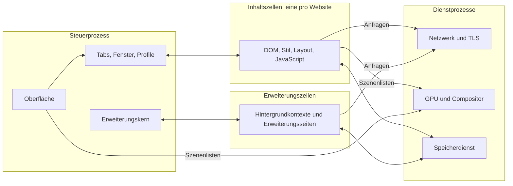
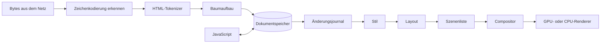
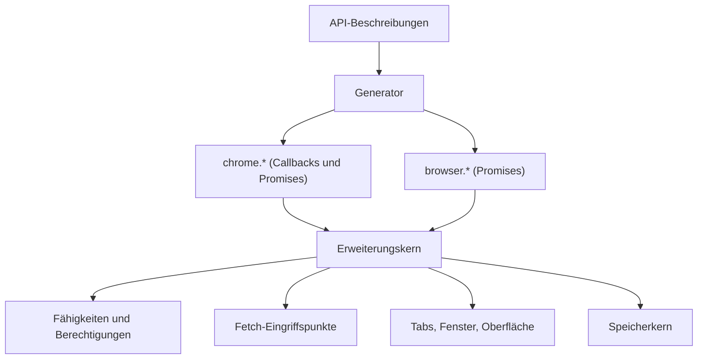

# MeinBrowser – Architekturkonzept

Stand: Entwurf vom 24.10.2026 · Status: zur Diskussion

Dieses Dokument beschreibt, wie MeinBrowser aufgebaut werden soll: welche Bausteine es gibt, wo wir bewusst andere Wege gehen als heutige Browser, wie die eigene JavaScript-Engine aussieht, wie Chrome- und Firefox-Erweiterungen laufen sollen und in welcher Reihenfolge wir bauen. Es ist ein Entwurf. Alles, was noch entschieden werden muss, steht gesammelt in [Abschnitt 13](#13-offene-entscheidungen).

## Inhalt

1. [Ziele und Leitplanken](#1-ziele-und-leitplanken)
2. [Die Grundideen](#2-die-grundideen)
3. [Gesamtbild](#3-gesamtbild)
4. [Die Komponenten im Einzelnen](#4-die-komponenten-im-einzelnen)
5. [Erweiterungen für Chrome und Firefox](#5-erweiterungen-für-chrome-und-firefox)
6. [Modifizierbarkeit und Skins](#6-modifizierbarkeit-und-skins)
7. [Ressourcenschonung](#7-ressourcenschonung)
8. [Plattformen](#8-plattformen)
9. [Kompatibilität messen](#9-kompatibilität-messen)
10. [Aufbau des Repositorys](#10-aufbau-des-repositorys)
11. [Roadmap und Meilensteine](#11-roadmap-und-meilensteine)
12. [Der Aufwand, ehrlich betrachtet](#12-der-aufwand-ehrlich-betrachtet)
13. [Offene Entscheidungen](#13-offene-entscheidungen)
14. [Quellen](#14-quellen)

---

## 1. Ziele und Leitplanken

**Ziele**

- **Open Source** unter der MIT-Lizenz (wie im Repository festgelegt).
- **Extrem ressourcenschonend**: wenig Arbeitsspeicher, schneller Start, kaum Energieverbrauch im Leerlauf.
- **Maximal kompatibel**: gemessen an den offiziellen Testsammlungen des Webs (web-platform-tests, Test262 und weitere, siehe [Abschnitt 9](#9-kompatibilität-messen)) und an echten Webseiten.
- **Erweiterungen**: Chrome- und Firefox-Erweiterungen laufen ohne Anpassung.
- **Modifizierbar und skinbar**: Aussehen und Verhalten lassen sich ändern, ohne den Browser neu zu übersetzen.
- **Läuft auf jedem System**: Linux, Windows und macOS zuerst, danach Android, BSD und weitere.
- **Komplett eigen**: eine von Grund auf neue Engine, ohne fremde Engines oder Bibliotheken.

### 1.1 Was „komplett eigen“ hier bedeutet

Ganz ohne fremden Code kann kein Programm laufen: Um ein Fenster zu öffnen, ins Netz zu gehen oder die Grafikkarte zu nutzen, muss der Browser mit dem Betriebssystem sprechen. Entschieden am 24.10.2026: Erlaubt sind die Rust-Standardbibliothek sowie die Schnittstellen von Betriebssystem und Grafiktreibern. Alles darüber bauen wir selbst, auch TLS und Kryptografie. Im Einzelnen:

| Kategorie | Regel |
|---|---|
| Code im ausgelieferten Browser | Alles selbst geschrieben: Parser, DOM, CSS, Layout, Rendering, Schriften, JavaScript, WebAssembly, Netzwerk, TLS, Bilder, Medien, Erweiterungen, Oberfläche. |
| Rust-Sprache und Standardbibliothek | Erlaubt (`core`, `alloc`, `std`). |
| Schnittstellen des Betriebssystems | Erlaubt: Systemaufrufe, Fenster und Eingabe, Zwischenablage, Barrierefreiheit, Zertifikatsspeicher, Schlüsselbund. Die Anbindung (FFI-Deklarationen) schreiben wir selbst, also keine Crates wie `libc`, `windows-sys` oder `objc`. |
| Grafiktreiber-Schnittstellen | Erlaubt: Vulkan, Metal, Direct3D 12. |
| Werkzeuge, die nicht ausgeliefert werden | Annahme: erlaubt. Gemeint sind Compiler, Cargo, Git, Profiler und Fuzzing-Werkzeuge der Toolchain. |
| Testsammlungen | Annahme: erlaubt. web-platform-tests, Test262, html5lib-tests und andere sind Prüfmaßstab, kein Bestandteil des Browsers. |
| Datensätze, die man nicht erfinden kann | Annahme: erlaubt, eingelesen mit eigenen Generatoren. Dazu gehören die Unicode-Zeichendatenbank, CLDR, die IANA-Zeitzonendatenbank, die Public Suffix List, die Liste vertrauenswürdiger Wurzelzertifikate, die HSTS-Preload-Liste, Silbentrennmuster und die IDL-Blöcke aus den Spezifikationen. Die Lizenzen jedes Datensatzes dokumentieren wir im Repository. |

**Durchsetzung:** Eine CI-Prüfung lehnt jeden Pull Request ab, dessen `Cargo.lock` ein Paket mit externer Quelle enthält (also mit einem `source`-Eintrag). So bleibt die Regel nicht nur ein Vorsatz.

### 1.2 Neu, wo es nützt, und exakt, wo das Web es verlangt

Webseiten sehen vom Browser nur sein Verhalten. Dieses Verhalten ist durch Spezifikationen festgelegt (WHATWG, W3C, TC39, Khronos, IETF) und in der Praxis zusätzlich durch das, was Chrome und Firefox tun. Hier dürfen wir nicht abweichen, sonst leidet die Kompatibilität.

Wie wir dieses Verhalten im Inneren herstellen, ist dagegen völlig frei. Dort setzen die Grundideen in [Abschnitt 2](#2-die-grundideen) an. Eine Einschränkung gilt trotzdem: Wo eine bekannte Technik nachweislich am besten funktioniert (zum Beispiel Inline-Caches für JavaScript-Eigenschaftszugriffe), bauen wir sie selbst nach, statt aus Prinzip eine schlechtere zu erfinden. Die Funktionalität soll unter dem Eigenbau nicht leiden.

---

## 2. Die Grundideen

Acht Entscheidungen prägen die Architektur. Zu jeder steht, was sie bringt und wo das Risiko liegt.

| Bereich | Häufiger Weg | MeinBrowser |
|---|---|---|
| Dokumentmodell | Objektbaum, jeder Knoten ein eigenes Heap-Objekt mit Zeigern | Spaltenspeicher mit 32-Bit-Indizes |
| Änderungen verfolgen | viele einzelne „dirty“-Markierungen je Subsystem | ein gemeinsames Änderungsjournal für alle |
| Spezifikationstreue | Spezifikationsschritte als Kommentare von Hand | Spezifikation als Quelltext, generiert und rückverfolgbar |
| Speicherfreigabe | ein Garbage Collector pro Prozess | Speicherregionen pro Dokument, beim Schließen sofort frei |
| Start neuer Fenster und Frames | eingebaute Objekte werden je Realm neu erzeugt oder aus einem Snapshot geladen | geteiltes, unveränderliches Abbild, Objekte entstehen erst bei Bedarf |
| Hintergrund-Tabs | verwerfen und beim Zurückkehren neu laden | einfrieren und als Abbild auslagern, ohne Neuladen |
| Grafik | häufig getrennte Rasterwege für Text und übrige Grafik | eine Vektorpipeline für alles, GPU und CPU rechnen gleich |
| Erweiterungen | je Browser ein eigenes API-Modell | ein Kern, `chrome.*` und `browser.*` aus einer Beschreibung erzeugt |

### 2.1 Spaltenspeicher statt Objektbaum

Das Dokument (DOM) ist kein Geflecht aus Objekten, sondern eine Tabelle. Jeder Knoten ist eine Nummer (32 Bit, plus Generationszähler gegen veraltete Verweise). Seine Eigenschaften liegen in Spalten: Knotenart, Elternknoten, erstes Kind, nächstes Geschwister, Name, Attribute, Text, berechneter Stil, Layout-Ergebnis, Markierungen.

- **Vorteile:** Wenig Speicher (32-Bit-Indizes statt 64-Bit-Zeigern, keine Verwaltungsdaten pro Einzelobjekt). Durchläufe sind cachefreundlich und lassen sich leicht auf Threads verteilen. Rust kommt damit natürlich zurecht, ohne `Rc<RefCell<…>>`-Geflechte. Ein ganzes Dokument lässt sich am Stück kopieren, einfrieren oder auf die Festplatte schreiben.
- **Risiko:** Manche DOM-Operationen (große Teilbäume verschieben, Knoten adoptieren) brauchen sorgfältige Freilisten und Kompaktierung. Das klären wir früh mit Messungen.

### 2.2 Ein Änderungsjournal für alles

Jede Änderung am Dokument landet in einem Journal: Knoten eingefügt, Attribut geändert, Text geändert. Alle Interessenten lesen dasselbe Journal: Stil-Invalidierung, Layout, `MutationObserver`, der Barrierefreiheitsbaum, die Entwicklerwerkzeuge und Erweiterungen.

- **Vorteile:** Eine einzige, prüfbare Stelle für „was hat sich geändert“. Fehler durch vergessene Invalidierung, eine häufige Fehlerquelle in Browsern, werden seltener. Neue Interessenten kommen ohne Eingriffe in den Kern hinzu.
- **Risiko:** Das Journal darf bei massenhaften Änderungen nicht zum Flaschenhals werden. Deshalb fasst es Folgen gleichartiger Änderungen zusammen und wird pro Darstellungsschritt geleert.

### 2.3 Spezifikation als Quelltext

Die WHATWG-Standards sind als Algorithmen geschrieben, viele davon als Zustandsautomaten (HTML-Tokenizer, Baumaufbau, URL-Parser, CSS-Syntax). Diese Teile beschreiben wir in einer kleinen eigenen Beschreibungssprache, nah am Wortlaut der Spezifikation. Ein eigener Generator erzeugt daraus Rust-Code, und jeder erzeugte Schritt trägt einen Verweis auf den Abschnitt der Spezifikation.

- **Vorteile:** Hohe Treue zur Spezifikation. Ändert sich ein Standard (die WHATWG-Standards werden laufend fortgeschrieben), meldet ein Werkzeug, welche referenzierten Abschnitte sich geändert haben. Die Abdeckung wird messbar.
- **Risiko:** Nicht alles lässt sich generieren. Layout und Grafik schreiben wir von Hand. Der Generator ist selbst Code, der gepflegt werden muss, deshalb setzen wir ihn nur dort ein, wo die Spezifikation wirklich tabellarisch ist.

### 2.4 Speicherregionen pro Dokument

Der JavaScript-Speicher ist in Regionen aufgeteilt: eine pro Agent (eine Ereignisschleife im Sinne der HTML-Spezifikation) und darin eine Unterregion pro Dokument. Objekte verschiedener Agents können sich laut Spezifikation nicht gegenseitig referenzieren, sie tauschen nur Kopien aus (`postMessage`, strukturiertes Klonen). Innerhalb einer Region arbeitet ein Garbage Collector mit Generationen.

- **Vorteile:** Wird ein Tab geschlossen, wird seine Region auf einen Schlag freigegeben, ohne Garbage-Collection-Lauf. Gibt es keine Verweise zwischen Dokumenten (der Normalfall), gilt das auch beim Wegnavigieren. Regionen lassen sich einzeln messen, begrenzen und einfrieren.
- **Risiko:** Gleichherkunfts-Frames dürfen Objekte teilen. Solche Verweise erfasst eine Schreibbarriere, und die betroffene Unterregion wird dann normal vom Garbage Collector behandelt statt pauschal freigegeben.

### 2.5 Geteilte, unveränderliche Abbilder

Alles, was in jedem Prozess gleich ist, wird beim Übersetzen einmal vorberechnet und als schreibgeschütztes Abbild per Speicherabbildung (`mmap`) von allen Prozessen geteilt: die Vorlagen aller eingebauten JavaScript-Objekte und DOM-Schnittstellen, das vorübersetzte Standard-Stylesheet, die Unicode-Tabellen. Systemschriften werden ebenfalls nur abgebildet, nicht kopiert.

Ein neues Realm (Fenster, Frame, Worker, Erweiterungskontext) erzeugt seine eingebauten Objekte erst, wenn ein Skript sie tatsächlich anfasst. Jedes Realm bekommt dabei weiterhin eigene Objekte, wie die Spezifikation es verlangt (`Array` im Frame ist nicht `Array` im Hauptdokument). Die Vorlagen dafür, also Gestalt, Eigenschaftstabellen und Code, kommen aus dem geteilten Abbild.

- **Vorteile:** Neue Realms starten fast ohne Kosten. Von vielen hundert DOM-Schnittstellen benutzt eine typische Seite nur einen Bruchteil.
- **Risiko:** Die verzögerte Erzeugung muss für Skripte unsichtbar sein. Das prüfen Test262 und die WPT-Tests zu WebIDL.

### 2.6 Einfrieren statt Verwerfen

Weil Dokument (Spaltenspeicher) und JavaScript-Speicher (Regionen) zusammenhängende Blöcke sind, lässt sich ein Hintergrund-Tab komplett einfrieren: anhalten, komprimieren, auf die Festplatte schreiben. Beim Zurückkehren wird er in seinem genauen Zustand wiederhergestellt, inklusive Formulareingaben, Scrollposition und Skriptzustand, ohne Neuladen.

- **Vorteile:** Sehr viele offene Tabs bei geringem Speicherverbrauch, ohne dass Seiten ihren Zustand verlieren.
- **Risiko:** Seiten mit offenen Verbindungen (WebSocket, WebRTC), laufender Wiedergabe oder geteiltem Speicher mit Workern lassen sich nicht ohne Verlust einfrieren. Für sie gelten Regeln ähnlich denen des Back-Forward-Caches der HTML-Spezifikation: Sie bleiben aktiv oder werden gedrosselt.

### 2.7 Eine Grafikpipeline für alles

Seiteninhalt, Text, Oberfläche und Skins laufen durch dieselbe Pipeline: Das Layout erzeugt eine kompakte Szenenliste (Pfade, Bilder, Glyphen, Effekte), die ein eigener, auf Compute-Shadern basierender Vektor-Renderer auf der GPU zeichnet. Ein CPU-Renderer mit denselben Algorithmen ist Rückfallebene und zugleich Referenz.

- **Vorteile:** Ein Codepfad statt mehrerer. Glyphen sind einfach Pfade. Die CPU-Variante macht Tests deterministisch und läuft auf jedem Gerät, auch ohne brauchbaren Grafiktreiber.
- **Risiko:** GPU-Vektorrasterung mit Compute-Shadern ist ein aktives Forschungsgebiet und anspruchsvoll. Für alte GPUs ohne Compute-Unterstützung zeichnet die CPU und lädt nur fertige Kacheln hoch.

### 2.8 Ein Erweiterungskern, zwei Gesichter

Intern gibt es genau ein Modell für Erweiterungen, mit Fähigkeiten (Capabilities) statt verstreuter Berechtigungsprüfungen. Die APIs beschreiben wir einmal in einem eigenen Beschreibungsformat. Ein Generator erzeugt daraus `chrome.*` (Callbacks und Promises) und `browser.*` (Promises, Firefox-Stil), samt Argumentprüfung und Testgerüsten. Details stehen in [Abschnitt 5](#5-erweiterungen-für-chrome-und-firefox).

---

## 3. Gesamtbild

### 3.1 Prozesse und Zellen

Seit den Spectre-Angriffen gilt: Inhalte verschiedener Websites gehören in getrennte Betriebssystemprozesse, weil Seitenkanäle Speicher innerhalb eines Prozesses auslesen können. Wir nennen eine solche Isolationseinheit **Zelle**.



- **Steuerprozess:** Oberfläche, Tab- und Fensterverwaltung, Profile, Berechtigungen, Erweiterungskern. Er hat die meisten Rechte und führt kein Webseiten-JavaScript aus.
- **Dienstprozesse:** Netzwerk (inklusive TLS und Cookies), GPU und Compositor, Speicherdienst (IndexedDB, Cache, Verlauf). Auf Geräten mit wenig Speicher lassen sie sich zu einem einzigen Dienstprozess zusammenlegen.
- **Inhaltszellen:** eine pro Website (Schema plus registrierbare Domain laut Public Suffix List). Sie sind stark eingeschränkt (Sandbox) und kommen an Dateien, Netz und Grafik nur über Nachrichten an die anderen Prozesse.
- **Erweiterungszellen:** Hintergrundkontexte, Popups und Optionsseiten von Erweiterungen.
- **Prozesskommunikation (IPC):** eigene, typisierte Nachrichten über Ringpuffer in gemeinsamem Speicher. Die Nachrichtentypen werden aus einer Schnittstellenbeschreibung generiert, damit Absender und Empfänger nie auseinanderlaufen.

### 3.2 Der Weg einer Seite



1. Der Netzwerkprozess liefert Bytes. Die Zeichenkodierung wird nach dem Encoding-Standard erkannt.
2. Tokenizer und Baumaufbau (generiert nach [2.3](#23-spezifikation-als-quelltext)) füllen den Dokumentspeicher. Skripte können den Parser laut Spezifikation anhalten und weiterschreiben (`document.write`).
3. Das Änderungsjournal sagt dem Stilsystem, welche Knoten neu zu berechnen sind.
4. Das Layout erzeugt einen unveränderlichen Fragmentbaum und daraus die Szenenliste.
5. Die Szenenliste geht über gemeinsamen Speicher an den Compositor. Er übernimmt Scrollen und einfache Animationen (Verschiebung, Transparenz) selbst, sodass Scrollen flüssig bleibt, auch wenn JavaScript gerade rechnet.

### 3.3 Threads und Planung

- Jede Inhaltszelle hat einen Hauptthread für die Ereignisschleife (wie es die HTML-Spezifikation vorgibt) und einen gemeinsamen Pool von Hilfsthreads für Stil, Layout, Bilddekodierung, Textformung und Garbage Collection.
- Ein eigener Planer verteilt Arbeit nach Priorität: Eingaben vor Animationsbildern, vor Darstellung, vor normalen Aufgaben, vor Leerlaufarbeit.
- Ein-/Ausgabe läuft über eine eigene Ereignisschicht auf den Mechanismen des Systems: `epoll` unter Linux, `kqueue` unter macOS und BSD, IOCP unter Windows.
- Leerlauf heißt Leerlauf: kein Abfragen in Schleifen, gebündelte Timer, keine Darstellung ohne Änderung.

---

## 4. Die Komponenten im Einzelnen

### 4.1 Fundament

Gemeinsame Bausteine für alle anderen Teile: Arenen und typisierte Indizes, Interning von Zeichenketten (Atome für Tag- und Attributnamen), Bitmengen, kompakte Zeichenketten (Latin-1 oder UTF-16), Fehler- und Protokollierungstypen sowie ein Speicherzähler je Subsystem, damit jeder Bereich seinen Verbrauch kennt.

### 4.2 Plattformschicht

Die einzige Stelle, die mit dem Betriebssystem spricht. Sie bietet dem Rest eine kleine, einheitliche Schnittstelle: Fenster, Eingabeereignisse, Zwischenablage, GPU-Oberfläche, Ein-/Ausgabe-Ereignisse, Dateizugriff, Prozesse und Sandbox, Systemschriften, Zertifikatsspeicher, Schlüsselbund, Barrierefreiheit und Eingabemethoden.

| System | Fenster und Eingabe | Grafik |
|---|---|---|
| Linux | eigener Wayland-Client und eigener X11-Client (beides dokumentierte Protokolle über Sockets, ohne `libwayland` oder `libX11`) | Vulkan, sonst CPU über gemeinsamen Speicher |
| Windows | Win32 | Direct3D 12, alternativ Vulkan, sonst CPU |
| macOS | AppKit über die Objective-C-Laufzeit | Metal, sonst CPU |
| Android | NDK-Schnittstellen (Native Activity) | Vulkan, sonst CPU |

Unter Linux sind viele „Systemfunktionen“ in Wirklichkeit Bibliotheken (fontconfig, libdbus, libwayland). Diese ersetzen wir durch eigene Implementierungen der zugrunde liegenden Protokolle und Dateiformate, zum Beispiel einen eigenen D-Bus-Client für Barrierefreiheit und Eingabemethoden.

### 4.3 Text und Unicode

- **Unicode-Tabellen** generieren wir aus der Unicode-Zeichendatenbank: Eigenschaften, Normalisierung (UAX #15), bidirektionaler Text (UAX #9), Zeilenumbruch (UAX #14), Segmentierung (UAX #29), internationalisierte Domainnamen (UTS #46).
- **Schriften:** eigener Leser für TrueType, OpenType (inklusive CFF und CFF2), variable Schriften, Farbschriften für Emoji (COLR, CBDT, sbix), WOFF und WOFF2 (mit eigenem Brotli-Dekoder). Für einige Systemschriften von macOS brauchen wir zusätzlich AAT-Tabellen.
- **Textformung (Shaping):** eigene Umsetzung von OpenType GSUB und GPOS, zuerst für lateinische, kyrillische und griechische Schrift, danach Arabisch, Hebräisch, indische Schriften, Thai und ostasiatische Schriften. Das ist einer der aufwendigsten Teile des ganzen Projekts.
- **Glyphen** sind Pfade und laufen durch die normale Grafikpipeline. Kleine Größen werden in einem Glyphenatlas zwischengespeichert.
- **Schriftauswahl und Ersatzschriften:** eigener Index der Systemschriften (Verzeichnisse und Systemschnittstellen), zwischengespeichert pro Profil.

### 4.4 Parser

| Parser | Grundlage | Hinweis |
|---|---|---|
| Zeichenkodierung | WHATWG Encoding | alle dort gelisteten Kodierungen, Tabellen aus den Daten des Standards generiert |
| URL | WHATWG URL | generierter Zustandsautomat, IDNA aus UTS #46 |
| HTML | WHATWG HTML | Tokenizer und Baumaufbau generiert, inklusive Fehlerbehandlung und Quirks-Modus |
| XML und XHTML, SVG | XML 1.0, Namespaces | eigener, nicht validierender Parser |
| CSS | CSS Syntax Level 3 | Tokenizer und Grundgrammatik generiert, Eigenschaftsgrammatiken aus einer Beschreibungsdatei |
| JSON | ECMA-404 | geteilt mit der JavaScript-Engine |
| JavaScript und WebAssembly | ECMA-262, WebAssembly | siehe [4.9](#49-javascript-und-webassembly) |

### 4.5 Dokumentspeicher (DOM)

- Spaltenspeicher wie in [2.1](#21-spaltenspeicher-statt-objektbaum), Änderungsjournal wie in [2.2](#22-ein-änderungsjournal-für-alles).
- JavaScript-Wrapper sind schlanke Verweise der Form (Realm, Knotennummer, Generation). Darum können mehrere Welten (Seite und Inhalts-Skripte von Erweiterungen) denselben Knoten mit getrennten Wrappern sehen, was die Erweiterungen in [Abschnitt 5](#5-erweiterungen-für-chrome-und-firefox) brauchen.
- Shadow DOM, Slots, Custom Elements, Ranges und Selection und `TreeWalker` setzen auf denselben Spalten auf.
- Darstellung und Skript sehen konsistente Versionen: Der Renderer liest einen Schnappschuss, während das Skript schon weiterarbeitet.

### 4.6 Stil

- Eigener Selektor-Abgleich mit Vorfiltern über die Vorfahrenkette, Kaskade mit Ebenen (`@layer`), Containerabfragen, `:has()` und Verschachtelung.
- **Stil-Interning:** Gleiche berechnete Stile werden nur einmal gespeichert. Die meisten Knoten einer Seite teilen sich wenige Stilvarianten.
- Berechnung parallel über Teilbäume, angestoßen durch das Änderungsjournal.
- Animationen und Übergänge (CSS Animations, Transitions, Web Animations) laufen über eine gemeinsame Zeitleiste. Was der Compositor allein kann, gibt die Zelle an ihn ab.

### 4.7 Layout

- **Layout als reine Funktion:** Eingabe sind ein Knoten und die Randbedingungen (verfügbare Breite und Höhe, Schreibrichtung), Ausgabe ein unveränderliches Fragment. Ergebnisse werden nach (Knoten, Randbedingungen, Stilversion) zwischengespeichert. Erneutes Layout berechnet nur, was sich wirklich geändert hat.
- **Formatierungskontexte** (Block, Inline, Flex, Grid, Tabelle, Mehrspaltig, Positionierung, Floats) sind getrennte Module mit gemeinsamer Schnittstelle. Unabhängige Kontexte werden parallel berechnet.
- **Inline-Layout:** Bidi, Zeilenumbruch, Silbentrennung, vertikale Schrift, Ruby.
- **Später:** Seitenlayout für den Druck (Paged Media).

### 4.8 Grafik

- **Szenenliste:** kompaktes Binärformat mit Pfaden, Bildern, Glyphenfolgen, Verläufen, Masken, Filtern und Mischmodi. Inhaltszellen und Oberfläche erzeugen beide Szenenlisten.
- **GPU-Renderer:** Compute-Shader zerlegen Pfade in Kacheln und rastern sie (siehe [2.7](#27-eine-grafikpipeline-für-alles)).
- **CPU-Renderer:** dieselben Algorithmen in Rust, für Tests, Rückfall und Geräte ohne geeignete GPU.
- **Eigener Shader-Übersetzer:** Wir brauchen ihn ohnehin für WebGL (GLSL ES) und WebGPU (WGSL). Er übersetzt sowohl diese Sprachen als auch unsere eigenen Shader nach SPIR-V (Vulkan), MSL (Metal) und HLSL (Direct3D). Ein Übersetzer, drei Nutzer.
- **Compositor:** Ebenen für Scrollbereiche, Videos, Canvas und Animationen. Auch Frames aus anderen Inhaltszellen werden hier zu einem Bild zusammengesetzt.
- **Canvas 2D, WebGL, WebGPU** bauen auf derselben GPU-Abstraktion auf.

### 4.9 JavaScript und WebAssembly

Ziel ist vollständiges ECMAScript in der jeweils aktuellen Ausgabe einschließlich der Internationalisierungs-API (ECMA-402), gemessen mit Test262.

**Ausführungsstufen**

1. **Parser:** erzeugt einen kompakten Syntaxbaum in einer Arena. Funktionskörper werden zunächst nur vorgeprüft und erst beim ersten Aufruf vollständig übersetzt. Die „early errors“, die die Spezifikation vorschreibt, werden trotzdem sofort gemeldet.
2. **Bytecode:** registerbasiert und kompakt. Übersetzter Bytecode wird pro Skript-Hash auf der Festplatte zwischengespeichert, sodass wiederholte Besuche ohne erneutes Parsen auskommen.
3. **Interpreter:** läuft überall und ist die Grundlage für alle Plattformen, auch für die, auf denen kein JIT erlaubt ist.
4. **Basis-JIT:** setzt vorgefertigte Maschinencode-Bausteine je Bytecode zusammen, zuerst für x86_64 und AArch64.
5. **Optimierender JIT (später):** eigene SSA-Zwischendarstellung, die JavaScript und WebAssembly gemeinsam nutzen. Ein Backend, zwei Sprachen.

Ein JIT-freier Modus bleibt immer verfügbar, als Sicherheitsoption und für eingeschränkte Plattformen.

**Laufzeit**

- **Objektmodell:** Objektgestalten (Shapes) mit Inline-Caches, dichte und dünn besetzte Array-Elemente. Das ist bewährte Technik, die wir eigenständig umsetzen.
- **Werte:** 64-Bit-Darstellung mit eingebetteten Zahlen. In Objekten gespeicherte Verweise sind innerhalb einer Region 32-Bit-Abstände (Regionen bis 4 GiB), das spart Speicher.
- **Speicher:** Regionen wie in [2.4](#24-speicherregionen-pro-dokument), präziser und verschiebender Garbage Collector mit Generationen. Verweise aus Rust-Code laufen über typisierte, bereichsgebundene Handles, sodass der Collector jeden Verweis kennt.
- **Zeichenketten:** Latin-1 oder UTF-16 je nach Inhalt, Ropes für zusammengesetzte Ketten, Interning für Eigenschaftsnamen.
- **Reguläre Ausdrücke:** eigene Engine mit der vollen JavaScript-Semantik (Rückverweise, Lookbehind, Unicode-Sets) und einem Automaten-Schnellpfad für einfache Muster.
- **Intl:** Daten aus CLDR und der IANA-Zeitzonendatenbank, mit eigenem Generator in kompakte Tabellen übersetzt.
- **Eingebaute Objekte** kommen aus dem geteilten Abbild ([2.5](#25-geteilte-unveränderliche-abbilder)).

**WebAssembly**

Eigener Validierer, Interpreter und Basis-Übersetzer. Später teilt es sich das optimierende Backend mit JavaScript. Zuerst kommt der Kernstandard, danach Erweiterungen wie Threads, SIMD, Ausnahmen und Garbage Collection.

### 4.10 Web-APIs und Bindings

- Die Schnittstellen der Webplattform sind in den Spezifikationen in WebIDL beschrieben. Ein eigenes Werkzeug zieht die IDL-Blöcke aus den Spezifikationen, und ein eigener Generator erzeugt daraus die Bindings: Typumwandlung, Argumentprüfung, Ausnahmen, Prototypen. Rust-Code implementiert nur noch die eigentliche Logik.
- Die Ereignisschleife, Timer, Microtasks und `requestAnimationFrame` folgen exakt dem Verarbeitungsmodell der HTML-Spezifikation.
- **Worker, Service Worker und Worklets** sind eigene Agents mit eigener Region.

### 4.11 Netzwerk und Kryptografie

- **Protokolle:** HTTP/1.1 (RFC 9112), HTTP/2 (RFC 9113 mit HPACK), HTTP/3 (RFC 9114 über QUIC nach RFC 9000, mit QPACK), WebSocket, später WebTransport.
- **Fetch:** Der Fetch-Standard wird als ein einziger Zustandsautomat umgesetzt, den Seiten, Worker, Service Worker und Erweiterungen gemeinsam nutzen. Die Eingriffspunkte für Erweiterungen (`webRequest`, `declarativeNetRequest`) liegen an fest definierten Stellen dieses Automaten.
- **Weitere Bausteine:** HTTP-Cache, Cookies (inklusive Partitionierung), HSTS, CORS, CSP, gemischte Inhalte, Proxy-Unterstützung. PAC-Dateien sind JavaScript und laufen in unserer eigenen Engine.
- **DNS:** eigener Resolver, der die Systemkonfiguration liest, plus DNS über HTTPS (RFC 8484).
- **Kompression:** eigene Dekoder für gzip und Deflate, Brotli und zstd.
- **TLS:** eigene Umsetzung von TLS 1.3 (RFC 8446) und TLS 1.2 für ältere Server, Zertifikatsprüfung mit eigenem ASN.1-, DER- und X.509-Code. Die Wurzelzertifikate kommen aus dem Systemspeicher oder aus einer mitgelieferten Liste.
- **Kryptografie:** AES-GCM, ChaCha20-Poly1305, SHA-2, HMAC, HKDF, X25519, ECDSA P-256 und P-384, RSA, Ed25519 sowie die hybride Post-Quanten-Schlüsselvereinbarung X25519MLKEM768, die aktuelle Browser standardmäßig anbieten. Dieselben Bausteine bedienen die Web Crypto API.

**Wichtig zur Kryptografie:** Wir schreiben sie selbst (siehe [1.1](#11-was-komplett-eigen-hier-bedeutet)). Selbst geschriebene Kryptografie ist aber ein ernstes Sicherheitsrisiko. Schon kleine Fehler, etwa Laufzeiten, die von geheimen Daten abhängen, können Schlüssel verraten. Deshalb gilt:

- Die Kryptografie liegt hinter einer schmalen Anbieter-Schnittstelle, damit sie bei Bedarf austauschbar ist.
- Jede Primitive wird gegen offizielle Testvektoren geprüft (NIST, RFCs, Project Wycheproof), gefuzzt und auf konstante Laufzeit untersucht.
- Vor einer öffentlichen Version prüft ein externes Audit diesen Teil.

### 4.12 Speicherung

Ein eigener, absturzsicherer Speicherkern (Schreib-Log plus B-Baum) trägt alles, was dauerhaft gespeichert wird: Cookies, `localStorage`, IndexedDB, Cache API, das Origin Private File System, Verlauf, Lesezeichen, Einstellungen und Erweiterungsspeicher. Passwörter werden zusätzlich mit dem Schlüsselbund des Systems verschlüsselt.

### 4.13 Bilder, Audio und Video

- **Bilder:** PNG, APNG, JPEG (Baseline und progressiv), GIF, WebP (VP8 und VP8L), AVIF (AV1), BMP, ICO, SVG (über die eigene Engine). Bilder werden erst beim Zeichnen in der angezeigten Größe dekodiert und außerhalb des Sichtbereichs wieder verworfen.
- **Audio und Video:** HTML-Medienelemente, Media Source Extensions, Web Audio, später WebRTC. Lizenzfreie Codecs implementieren wir selbst: VP8, VP9, AV1, Opus, Vorbis, FLAC, MP3.
- **Patentbelastete Codecs** (H.264, AAC, HEVC) brauchen sehr viele Webseiten. Hier ist zu entscheiden, ob wir sie über die Medienschnittstellen des Betriebssystems nutzen, die zugleich Hardwaredekodierung bieten. Die Patentlage muss vor einer Veröffentlichung geklärt werden.
- **DRM (EME, etwa Widevine):** Nur mit einem proprietären, lizenzierten Modul eines Drittanbieters möglich, also nicht „eigen“. Ohne DRM laufen viele Streamingdienste nicht. Das ist eine offene Entscheidung.

### 4.14 Sicherheit und Sandbox

- **Rust schützt vor Speicherfehlern**, solange kein `unsafe` im Spiel ist. Darum steht in allen Crates außer wenigen ausgewiesenen (Plattformschicht, JIT, Garbage Collector, IPC) `#![forbid(unsafe_code)]`. Die Ausnahmen werden besonders geprüft und gefuzzt.
- **Sandbox je System:** unter Linux seccomp-bpf, Namespaces und Landlock, unter Windows AppContainer, eingeschränkte Tokens und Job-Objekte, unter macOS die Seatbelt-Sandbox.
- **Fähigkeiten statt Umgebungsrechten:** Eine Komponente bekommt nur Handles auf das, was sie braucht. Eine Inhaltszelle öffnet keine Dateien selbst, sie bekommt sie vom Steuerprozess, wenn der Nutzer sie ausgewählt hat.
- **JIT-Speicher** ist nie gleichzeitig beschreibbar und ausführbar (W^X).
- **Updates** sind signiert, und der Update-Mechanismus ist selbst geschrieben.

### 4.15 Barrierefreiheit und Eingabemethoden

- Der Barrierefreiheitsbaum entsteht aus Dokumentspeicher und Änderungsjournal und wird über die Systemschnittstellen bereitgestellt: UI Automation unter Windows, NSAccessibility unter macOS, AT-SPI über D-Bus unter Linux.
- Eingabemethoden für Chinesisch, Japanisch, Koreanisch und andere Sprachen laufen über TSF unter Windows, `NSTextInputClient` unter macOS sowie IBus oder Fcitx über D-Bus beziehungsweise das Wayland-Protokoll `text-input` unter Linux.
- Beides ist viel Arbeit, darf aber nicht bis zum Schluss warten. Ein Browser ohne Barrierefreiheit ist für viele Menschen nicht benutzbar.

### 4.16 Entwicklerwerkzeuge und Automatisierung

- Eigene Entwicklerwerkzeuge, gebaut mit der eigenen Engine.
- **Protokolle:** WebDriver (klassisch) und WebDriver BiDi, außerdem eine Teilmenge des Chrome DevTools Protocol. Damit lassen sich Werkzeuge wie Selenium und Puppeteer anbinden, und die vollständige Ausführung der web-platform-tests wird möglich.
- **Kopfloser Modus** (ohne Fenster) für Tests und Automatisierung.

---

## 5. Erweiterungen für Chrome und Firefox

### 5.1 Ziel

Erweiterungen aus dem Chrome Web Store und von addons.mozilla.org laufen ohne Änderung. Das betrifft Manifest V3 (Chrome und Firefox) und Manifest V2, das Firefox weiter unterstützt.

### 5.2 Aufbau



- **Ein internes Modell:** Eine Erweiterung besteht aus Manifest, Dateien, Fähigkeiten (aus `permissions` und `host_permissions`) und Kontexten: Hintergrund, Inhalts-Skripte, Erweiterungsseiten (Popup, Optionen, Seitenleiste) und Offscreen-Dokumente.
- **Eine Beschreibung pro API-Namensraum,** erstellt aus der öffentlichen Dokumentation von Chrome und MDN. Abweichungen zwischen den Browsern sind dort ausdrücklich markiert (nur Chrome, nur Firefox, unterschiedliches Verhalten). Der Generator erzeugt beide Gesichter, Argumentprüfung, Dokumentation und Testgerüste.
- **Hintergrund:** Chrome nutzt in Manifest V3 Service Worker, Firefox Hintergrundskripte und Event-Pages. Beides bilden wir auf denselben ereignisgesteuerten Kontext ab, der schlafen gelegt und bei Bedarf geweckt wird. Das spart Speicher.
- **Inhalts-Skripte** laufen in isolierten Welten: ein eigenes globales Objekt pro Erweiterung auf demselben DOM, möglich durch die schlanken Wrapper aus [4.5](#45-dokumentspeicher-dom). Firefox-Besonderheiten wie `wrappedJSObject`, `cloneInto` und `exportFunction` werden ebenfalls unterstützt.
- **Netzwerkeingriffe:** `declarativeNetRequest` wird in einen kompakten Regelautomaten übersetzt, schnell und speichersparend, was Werbeblockern zugutekommt. Blockierendes `webRequest` steht wie in Firefox in allen Manifest-Versionen zur Verfügung, auch für Chrome-Erweiterungen.
- **Pakete:** CRX3 (ZIP mit Protobuf-Kopf und Signaturen) und XPI (ZIP mit Signatur), gelesen mit eigenem ZIP-, Deflate- und Protobuf-Code.
- **Updates** über `update_url` (Chrome) beziehungsweise `browser_specific_settings.gecko.update_url` (Firefox).
- **Themes:** Chrome-Themes (`theme` im Manifest) und Firefox-Themes (`theme`-Schlüssel und Theme-API) werden auf die Design-Token aus [Abschnitt 6](#6-modifizierbarkeit-und-skins) abgebildet.
- **Native Messaging** startet das native Hilfsprogramm über die Prozessschnittstelle des Systems, wie in Chrome und Firefox.

### 5.3 Reihenfolge der APIs

1. `runtime`, `storage`, `i18n`, `permissions`, Inhalts-Skripte und `scripting`
2. `tabs`, `windows`, `action` und `browserAction`, `contextMenus`, `alarms`, `notifications`, `commands`
3. `declarativeNetRequest`, `webRequest`, `webNavigation`, `cookies`
4. `downloads`, `history`, `bookmarks`, `sidePanel` und `sidebarAction`, `offscreen`, `identity`
5. `devtools.*`, sobald die eigenen Entwicklerwerkzeuge stehen

### 5.4 Kompatibilität prüfen

Eine gemeinsame offizielle Testsammlung wie die WPT gibt es für Erweiterungs-APIs nach unserem Kenntnisstand nicht. Die W3C WebExtensions Community Group arbeitet an einer gemeinsamen Grundlage, der wir folgen. Wir bauen zusätzlich eigene API-Tests aus der Dokumentation und eine Liste realer Zielerweiterungen als Abnahmetest, zum Beispiel uBlock Origin, Dark Reader und Bitwarden.

Offen ist, wie die Installation direkt aus den Stores aussieht, denn beide Stores haben eigene Nutzungsbedingungen (siehe [Abschnitt 13](#13-offene-entscheidungen)).

---

## 6. Modifizierbarkeit und Skins

Der Browser soll sich auf vier Ebenen anpassen lassen, von einfach bis tief.

1. **Skins:** Die Oberfläche wird von der eigenen Engine gezeichnet, beschrieben in einer deklarativen Teilmenge von HTML und CSS. Ein Skin ist eine Datei mit Design-Token (Farben, Abstände, Schriften, Radien) plus beliebigem CSS für die Oberfläche. Skins lassen sich im laufenden Betrieb wechseln. Chrome- und Firefox-Themes werden automatisch übersetzt.
2. **Anordnung:** Leisten, Knöpfe und Seitenleisten sind frei anordenbar. Die Anordnung steht als Klartext in einer Datei und lässt sich teilen.
3. **Erweiterungen:** wie in [Abschnitt 5](#5-erweiterungen-für-chrome-und-firefox).
4. **Mods:** WebAssembly-Module mit einer eigenen Fähigkeiten-API für Oberfläche, Tabs, Tastenkürzel, eigene Panels und Netzwerk-Hooks. Mods sind abgeschottet, in jeder Sprache schreibbar, die nach WebAssembly übersetzt, und ohne Neustart nachladbar.

Darunter liegt der offene Quelltext mit klaren Crate-Grenzen. Feature-Schalter ermöglichen schlanke Varianten, etwa ohne WebGPU oder WebRTC für schwache Geräte.

Die Oberfläche selbst führt kein JavaScript aus. Ihre Logik ist in Rust geschrieben, eigene Logik kommt über Mods. Das spart einen ganzen JavaScript-Kontext im Steuerprozess. Popups und Optionsseiten von Erweiterungen sind dagegen normale Webseiten und laufen in Erweiterungszellen.

---

## 7. Ressourcenschonung

**Mechanismen**

1. Kompakte Datenstrukturen: 32-Bit-Indizes, Interning, Stil-Teilung ([2.1](#21-spaltenspeicher-statt-objektbaum), [4.6](#46-stil)).
2. Geteilte Abbilder für alles Unveränderliche ([2.5](#25-geteilte-unveränderliche-abbilder)).
3. Alles verzögert: Funktionskörper, eingebaute Objekte, Bilddekodierung, Schriftdaten.
4. Speicherbudgets mit Druckstufen: Unter Speicherdruck werden zuerst Caches geleert (Bilder, Glyphen, Bytecode), danach Hintergrund-Tabs eingefroren und ausgelagert ([2.6](#26-einfrieren-statt-verwerfen)).
5. Energie: keine Abfrageschleifen, gebündelte Timer, stark gedrosselte Hintergrund-Tabs, Darstellung nur bei Änderung, schlafender GPU-Prozess.
6. Zusammenlegbare Dienstprozesse auf schwachen Geräten ([3.1](#31-prozesse-und-zellen)).
7. Messen statt hoffen: Speicherzähler je Subsystem und Messläufe in der CI, damit Rückschritte sofort auffallen.

**Erste Zielwerte.** Das sind Ziele, keine Messungen. Wir überprüfen sie ab Meilenstein M5 an echter Hardware und passen sie an.

| Kennzahl | Zielwert |
|---|---|
| Kaltstart bis bedienbares Fenster | unter 300 ms |
| Zusätzlicher Arbeitsspeicher für einen leeren Tab | unter 10 MB |
| Aufwachvorgänge eines Hintergrund-Tabs im Leerlauf | höchstens einer pro Minute |
| Größe des Programms | unter 40 MB |

---

## 8. Plattformen

| Stufe | Systeme | Bedeutung |
|---|---|---|
| 1 | Linux (Wayland und X11), Windows 10 und 11, macOS; jeweils x86_64 und AArch64 | Jeder Pull Request wird darauf gebaut und getestet. |
| 2 | Android, FreeBSD | Regelmäßige Builds, Fehler werden zeitnah behoben. |
| 3 | iOS und iPadOS, weitere BSDs, RISC-V | Best-Effort. |

Zu iOS: Apple erlaubt eigene Browser-Engines nur in einzelnen Regionen (in der EU seit iOS 17.4) und nur mit besonderer Berechtigung. Wo das nicht gilt, muss ein Browser auf iOS WebKit verwenden, was unserem Grundsatz widerspricht.

Auf Plattformen ohne JIT-Erlaubnis läuft JavaScript über den Interpreter. Die Engine funktioniert dort vollständig, nur langsamer.

---

## 9. Kompatibilität messen

| Testsammlung | Prüft | Ab |
|---|---|---|
| html5lib-tests | HTML-Tokenizer und Baumaufbau | M1 |
| URL-Testdaten der WPT (`url/`, als JSON ohne JavaScript ausführbar) | URL-Parser | M1 |
| web-platform-tests (testharness.js und Referenztests) | DOM, HTML, CSS, Fetch und alle Web-APIs | M2 |
| Test262 | JavaScript | M2 |
| WebAssembly-Spezifikationstests | WebAssembly | M7 |
| Khronos WebGL Conformance Tests | WebGL | M7 |
| eigene API-Tests und Zielerweiterungen | Erweiterungen | M6 |
| Liste meistbesuchter Seiten | Alltagstauglichkeit | M5 |

- **Ein eigener Testläufer** führt die WPT-Dateien im kopflosen Modus direkt aus, schon bevor WebDriver fertig ist. Später kommt die Anbindung an den offiziellen Testläufer der WPT hinzu, damit die Ergebnisse auch auf wpt.fyi erscheinen.
- **Jede Nacht** läuft die gesamte Sammlung, die Ergebnisse werden als Zeitreihe je Bereich festgehalten. Jeder Pull Request führt die betroffenen Bereiche aus. Rückschritte blockieren den Merge.
- **Referenztests** werden mit dem CPU-Renderer ausgeführt, damit die Ergebnisse unabhängig von Grafiktreibern sind.
- **Prioritäten** richten sich nach dem, was das Web tatsächlich nutzt. Dafür gibt es öffentliche Nutzungsstatistiken, etwa Chrome Platform Status und das HTTP Archive.
- **Kompatibilität im echten Web:** Quirks-Modus und der WHATWG Compatibility Standard werden umgesetzt. Viele Seiten werten den User-Agent aus, deshalb gibt es wählbare User-Agent-Profile. Seitenspezifische Korrekturen werden, wenn nötig, offen dokumentiert.

---

## 10. Aufbau des Repositorys

Ein Cargo-Workspace, ausschließlich mit eigenen Crates. Vorschlag:

```text
MeinBrowser/
├── Cargo.toml               Workspace
├── crates/
│   ├── mb-base/             Arenen, Indizes, Atome, Zeichenketten, Bitmengen, Speicherzähler
│   ├── mb-platform/         Fenster, Eingabe, Ein-/Ausgabe, GPU-Oberfläche, Sandbox (eigene FFI)
│   ├── mb-ipc/              Prozesskommunikation über gemeinsamen Speicher
│   ├── mb-unicode/          generierte Unicode-Tabellen und Algorithmen
│   ├── mb-encoding/         WHATWG Encoding
│   ├── mb-url/              WHATWG URL
│   ├── mb-html/             Tokenizer und Baumaufbau
│   ├── mb-xml/              XML, XHTML, SVG-Parser
│   ├── mb-dom/              Dokumentspeicher und Änderungsjournal
│   ├── mb-css/              CSS-Parser und Eigenschaftsgrammatiken
│   ├── mb-style/            Selektoren, Kaskade, berechnete Stile
│   ├── mb-layout/           Formatierungskontexte, Fragmente
│   ├── mb-text/             Schriften, Textformung, Zeilenumbruch
│   ├── mb-scene/            Szenenliste
│   ├── mb-raster/           CPU-Renderer
│   ├── mb-gpu/              GPU-Abstraktion, GPU-Renderer, Compositor
│   ├── mb-shader/           Shader-Übersetzer (GLSL ES, WGSL, eigene Shader)
│   ├── mb-js/               JavaScript-Engine
│   ├── mb-wasm/             WebAssembly
│   ├── mb-webidl/           IDL-Leser und Binding-Generator
│   ├── mb-web/              Web-APIs, Ereignisschleife, Worker
│   ├── mb-compress/         Deflate, Brotli, zstd, ZIP
│   ├── mb-crypto/           Kryptografie hinter einer Anbieter-Schnittstelle
│   ├── mb-net/              DNS, HTTP/1.1/2/3, QUIC, TLS, Fetch, Cookies
│   ├── mb-storage/          Speicherkern
│   ├── mb-image/            Bildformate
│   ├── mb-media/            Audio, Video, Codecs
│   ├── mb-ext/              Erweiterungskern und generierte APIs
│   ├── mb-ui/               Browser-Oberfläche, Skins, Mods
│   ├── mb-devtools/         Entwicklerwerkzeuge, WebDriver, CDP
│   └── meinbrowser/         Programm
├── tools/
│   ├── codegen/             Generator für die Spezifikations-Beschreibungen
│   ├── datagen/             Generatoren für Unicode, CLDR, Zeitzonen und weitere Daten
│   ├── deps-guard/          CI-Prüfung: keine externen Abhängigkeiten
│   └── testrunner/          WPT-, Test262- und html5lib-Läufer
├── data/                    Rohdaten mit Lizenzhinweisen
├── docs/                    Dokumentation (dieses Dokument)
└── tests/                   eigene Tests
```

Große Testsammlungen wie die WPT werden nicht ins Repository kopiert, sondern in der CI in einer festgelegten Version geholt.

---

## 11. Roadmap und Meilensteine

Die Meilensteine bauen aufeinander auf, viele Teile lassen sich aber parallel bearbeiten. Jeder Meilenstein hat ein prüfbares Abschlusskriterium. Bewusst stehen hier keine Termine, denn die hängen davon ab, wie viele Menschen mitarbeiten (siehe [Abschnitt 12](#12-der-aufwand-ehrlich-betrachtet)).

| # | Meilenstein | Inhalt | Fertig, wenn |
|---|---|---|---|
| M0 | Fundament | Workspace, CI für Linux, Windows und macOS, Abhängigkeitswächter, Unicode-Generator, Plattformschicht mit Fenster, Eingabe und CPU-Bildausgabe | Ein Fenster zeigt auf allen drei Systemen ein selbst gezeichnetes Testbild, die CI ist grün. |
| M1 | Erstes Dokument | Encoding, URL, HTML-Parser, Dokumentspeicher, CSS-Grundlagen, Block- und Inline-Layout, einfache Textformung, Systemschriften, CPU-Renderer | html5lib-tests vollständig bestanden, die URL-Testdaten der WPT weitgehend bestanden, eine lokale HTML-Datei wird korrekt angezeigt. |
| M2 | JavaScript | Parser, Bytecode, Interpreter, Garbage Collector, eingebaute Objekte (ohne Intl), WebIDL-Generator, DOM-Bindings, Ereignisschleife, eigener WPT-Läufer | Test262 ohne Intl zu einem hohen Anteil bestanden, testharness.js läuft, WPT-Ergebnisse für DOM-Bereiche werden täglich gemessen. |
| M3 | Netzwerk | DNS, HTTP/1.1, TLS 1.3 und 1.2, X.509, Kompression, Cookies, Fetch, HTTP-Cache, HSTS | Beliebige HTTPS-Seiten laden. WPT-Bereiche zu Fetch und Cookies werden gemessen. |
| M4 | Modernes Layout und GPU | Flex, Grid, Positionierung, Floats, Tabellen, Scrollen, Transformationen, Filter, Animationen, GPU-Renderer, Compositor | CSS-Bereiche der WPT erreichen ihre Zielquoten, CPU- und GPU-Renderer stimmen in den Referenztests überein. |
| M5 | Alltagstauglich | Formulare, Frames, Navigation und Verlauf, Prozessisolation und Sandbox, Speicherung, alle Bildformate, WOFF2, komplexe Schriften, Bidi, HTTP/2, Canvas 2D, SVG, Oberfläche mit Tabs, Lesezeichen und Downloads, Skins, WebDriver | Die Liste meistbesuchter Seiten ist bedienbar, die Entwickler nutzen den Browser im Alltag. |
| M6 | Erweiterungen | Manifest V2 und V3 von Chrome und Firefox, CRX3 und XPI, Inhalts-Skripte, die APIs aus [5.3](#53-reihenfolge-der-apis) Stufe 1 bis 3, Themes | Die Zielerweiterungen laufen ohne Änderung. |
| M7 | Medien und Grafik | Audio, Video, Media Source Extensions, eigene Codecs, Web Audio, WebGL 1 und 2, WebGPU, WebAssembly, Intl | Videoseiten ohne DRM spielen ab, Konformitätstests für WebGL und WebAssembly werden gemessen. |
| M8 | Leistung | Basis-JIT, Einfrieren von Tabs, paralleles Stil und Layout, HTTP/3 und QUIC, später optimierender JIT | Die Zielwerte aus [Abschnitt 7](#7-ressourcenschonung) sind erreicht, Speedometer und JetStream werden regelmäßig gemessen. |
| M9 | Breite | Android, weitere Architekturen, vollständige Barrierefreiheit und Eingabemethoden, Entwicklerwerkzeuge und CDP, WebRTC, Service Worker, Push | Stufe-2-Plattformen laufen, Screenreader-Tests auf allen Stufe-1-Systemen bestehen. |
| M10 | Version 1.0 | Externes Sicherheitsaudit (insbesondere Kryptografie, Sandbox, JIT), signierte Updates, Absturzberichte, Datenschutzprüfung, Doku für Skin- und Mod-Autoren | Das Audit ist abgeschlossen und alle kritischen Befunde sind behoben. |

Barrierefreiheit (M9) wird schon ab M5 mitgedacht und nicht erst am Ende angefangen.

---

## 12. Der Aufwand, ehrlich betrachtet

Ein Browser, der heutige Webseiten zuverlässig darstellt und die Webtests weitgehend besteht, gehört zu den größten Softwareprojekten überhaupt. Allein JavaScript-Engine, Textformung für alle Schriften, CSS-Layout oder ein Videocodec wie AV1 sind jeweils ein eigenes, jahrelanges Vorhaben.

Ein Vergleich: Ladybird, ein unabhängiger Browser mit eigener Engine, begann 2019 als HTML-Betrachter im Hobbyprojekt SerenityOS. Heute arbeitet ein kleines Vollzeit-Team daran. Die erste Alpha-Version ist für 2026 angekündigt, Beta und stabile Version sind laut Wikipedia für 2027 und 2028 geplant. Selbst Ladybird nutzt für Bild-, Audio- und Videoformate, Verschlüsselung und Grafik inzwischen fremde Bibliotheken. Unser Grundsatz, das alles selbst zu bauen, macht den Weg also noch länger.

Was daraus folgt:

- **Ein alltagstauglicher Stand (M5) ist eine Frage von Jahren, nicht von Monaten,** und das umso mehr, je weniger Menschen mitarbeiten.
- **Klare Prioritäten:** zuerst das, was die meisten Seiten brauchen. Messbarer Fortschritt über die WPT hält das Projekt ehrlich und motivierend.
- **Parallelisierbarkeit:** Die Crate-Grenzen sind so gezogen, dass viele Menschen gleichzeitig an getrennten Teilen arbeiten können. Das ist wichtig, um Mitwirkende zu gewinnen.
- **Früh sichtbare Ergebnisse:** M0 und M1 liefern schnell etwas Vorzeigbares. Das hilft, Mitstreiter zu finden.

---

## 13. Offene Entscheidungen

**Bereits entschieden (24.10.2026)**

- **Grenze des Eigenbaus:** Rust-Standardbibliothek sowie Betriebssystem- und Grafikschnittstellen sind erlaubt, alles andere ist eigen ([1.1](#11-was-komplett-eigen-hier-bedeutet)).
- **Kryptografie und TLS:** selbst geschrieben, mit Testvektoren, Fuzzing und externem Audit ([4.11](#411-netzwerk-und-kryptografie)).

**Noch offen**

1. **Werkzeuge, Testsammlungen und Datensätze:** Gelten sie als erlaubt, wie in [1.1](#11-was-komplett-eigen-hier-bedeutet) angenommen?
2. **Patentbelastete Codecs** (H.264, AAC, HEVC): über die Medienschnittstellen des Systems nutzen oder weglassen?
3. **DRM:** ein lizenziertes Fremdmodul wie Widevine unterstützen oder bewusst darauf verzichten?
4. **Erweiterungen aus den Stores:** Wie sieht die Installation direkt aus dem Chrome Web Store und von addons.mozilla.org aus, mit Blick auf deren Nutzungsbedingungen? Prüfen wir die Signaturen der Stores?
5. **Rust-Version:** Edition 2024 und eine festgelegte Mindestversion des Compilers.
6. **Mitwirkung:** Beitragsregeln (zum Beispiel Developer Certificate of Origin), Code-Review-Regeln, Umgang mit `unsafe`.
7. **Telemetrie:** keine, oder nur freiwillig?

---

## 14. Quellen

**Spezifikationen und Testsammlungen**

- WHATWG HTML: <https://html.spec.whatwg.org/>
- WHATWG DOM: <https://dom.spec.whatwg.org/>
- WHATWG URL: <https://url.spec.whatwg.org/>
- WHATWG Encoding: <https://encoding.spec.whatwg.org/>
- WHATWG Fetch: <https://fetch.spec.whatwg.org/>
- WHATWG Web IDL: <https://webidl.spec.whatwg.org/>
- WHATWG Compatibility: <https://compat.spec.whatwg.org/>
- ECMAScript (ECMA-262): <https://tc39.es/ecma262/>
- ECMAScript Internationalization API (ECMA-402): <https://tc39.es/ecma402/>
- CSS-Spezifikationen des W3C: <https://www.w3.org/Style/CSS/>
- WebAssembly: <https://webassembly.github.io/spec/>
- web-platform-tests: <https://web-platform-tests.org/>, Ergebnisse: <https://wpt.fyi/>
- Test262: <https://github.com/tc39/test262>
- html5lib-tests: <https://github.com/html5lib/html5lib-tests>
- W3C WebExtensions Community Group: <https://www.w3.org/community/webextensions/>
- Chrome-Erweiterungen: <https://developer.chrome.com/docs/extensions>
- Firefox-Erweiterungen (MDN): <https://developer.mozilla.org/docs/Mozilla/Add-ons/WebExtensions>

**Zum Vergleich mit Ladybird ([Abschnitt 12](#12-der-aufwand-ehrlich-betrachtet))**

- Ladybird, Startseite und FAQ (eigene Engine, kleines Vollzeit-Team, Fremdbibliotheken für Medienformate, Verschlüsselung und Grafik): <https://ladybird.org/>
- Ankündigung vom 1. Juli 2024 (Ursprung als HTML-Betrachter in SerenityOS): <https://ladybird.org/posts/announcement/>
- Wikipedia (geplant: Alpha 2026, Beta 2027, stabile Version 2028): <https://en.wikipedia.org/wiki/Ladybird_(web_browser)>
- Zeitleiste ab Juni 2019 (Dokumentationskopie eines Drittanbieters): <https://mintlify.wiki/LadybirdBrowser/ladybird/faq>
